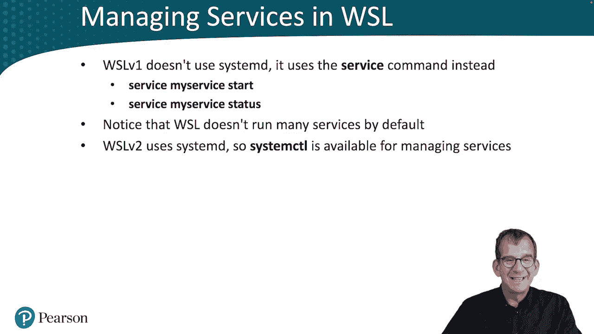
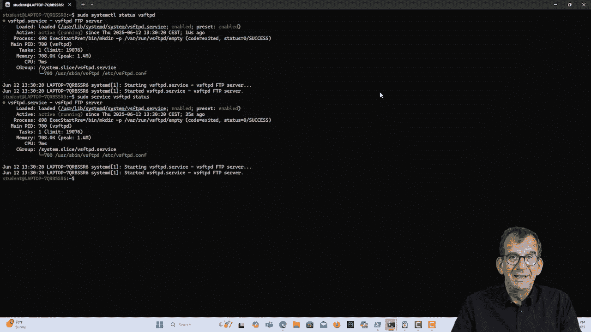

# CompTIA Linux+ V8：146：在 WSL 中管理服务 🐧


在本节课中，我们将要学习如何在 Windows 子系统 Linux（WSL）里管理系统服务。很多初学者在这里容易混淆，主要是因为 WSL 有两个主要版本，它们处理服务的方式完全不同。我们会先解释清楚为什么会出现这种差异，然后分别看看在 WSL 1 和 WSL 2 中该如何操作，最后通过一个实际例子演示整个过程。读完本节，你就能明白在不同 WSL 版本里该用什么命令来启动、查看或停止服务了。


## 为什么 WSL 里会有两种管理方式？

WSL 的不同版本在底层机制上有明显区别，这直接决定了你该用什么命令来管理服务。简单来说，WSL 1 比较老旧，不支持现在主流的系统服务管理器，而 WSL 2 则更接近真正的 Linux 发行版。如果你搞错了命令，可能会发现明明服务已经运行，却查不到状态，或者明明输入了命令却没有任何反应。


以下是两个 WSL 版本的核心区别：

- WSL 1：不使用 systemd，改用传统的 `service` 命令来管理服务。
- WSL 2：使用 systemd，可以直接使用 `systemctl` 命令，操作方式与普通 Linux 发行版一致。


## WSL 2 中使用 systemctl 管理服务

如果你使用的是 WSL 2，事情会变得非常简单。因为 WSL 2 内置了 systemd，所以你可以像在 Ubuntu、CentOS 等普通 Linux 系统中一样，直接使用 `systemctl` 来查看服务状态、启动服务或停止服务。不需要记额外的命令，也不需要担心语法顺序，就按惯例来就行。


以下是常见的 systemctl 操作命令：

- `systemctl status 服务名称`：查看指定服务当前是否运行。
- `systemctl start 服务名称`：启动指定服务。
- `systemctl stop 服务名称`：停止指定服务。
- `systemctl restart 服务名称`：重启指定服务。


## WSL 1 中使用 service 命令管理服务

对于 WSL 1 来说，因为没有 systemd，所以不能用 `systemctl`，必须改用老派的 `service` 命令。这里有个容易让人混淆的地方：`service` 命令的参数顺序和 `systemctl` 正好相反。在 `systemctl` 里通常是先写动作（比如 status），后写服务名；而在 `service` 命令里，则是先写服务名，后写动作。


以下是 service 命令的基本格式：

```bash
service 服务名称 start|status|stop|restart
```

比如，如果你想查看 vsftpd 服务的状态，在 WSL 1 中应该输入：



```bash
service vsftpd status
```

而如果你习惯性地输入了 `systemctl status vsftpd`，系统可能会直接提示找不到命令，这就是典型的版本不兼容问题。


## 实际演示：在 WSL 中安装并查看 FTP 服务

现在我们来看一个具体的例子，帮你把上面的理论知识落地。假设我们在 WSL 2 里安装了一个 FTP 服务器软件 vsftpd，然后想确认它是否正常运行。整个流程大概分三步：先安装软件，再清屏方便观察，最后用命令检查服务状态。


以下是演示中使用的命令顺序：

```bash
sudo apt install -y vsftpd
clear
sudo systemctl status vsftpd
```

执行完上面这些命令后，屏幕上会显示 vsftpd 的运行信息，如果你能看到类似 "active (running)" 的字样，就说明服务已经正常启动了。这个过程在 WSL 2 里非常顺畅，因为 systemctl 现成可用。


如果你是在 WSL 1 中做同样的事情，安装步骤差不多，但查看状态时就不能用 systemctl 了，需要改成下面这样：

```bash
sudo service vsftpd status
```

这条命令给出的信息和 systemctl 差不多，只是命令本身不同。所以记住一个原则即可：WSL 2 用 systemctl，WSL 1 用 service，不要混淆。




## 本节小结


本节课中，我们一起学习了在 WSL 环境下管理服务的两种方式。首先明确了 WSL 1 不支持 systemd，必须依赖 `service` 命令；其次了解到 WSL 2 支持 systemd，可以直接用 `systemctl` 管理服务。接着我们掌握了两种命令的基本语法和参数顺序，最后通过安装 vsftpd 的实例演示了如何查看服务运行状态。希望这些内容能帮你彻底搞清楚 WSL 里的服务管理问题，以后遇到类似情况就不会再混淆了。

