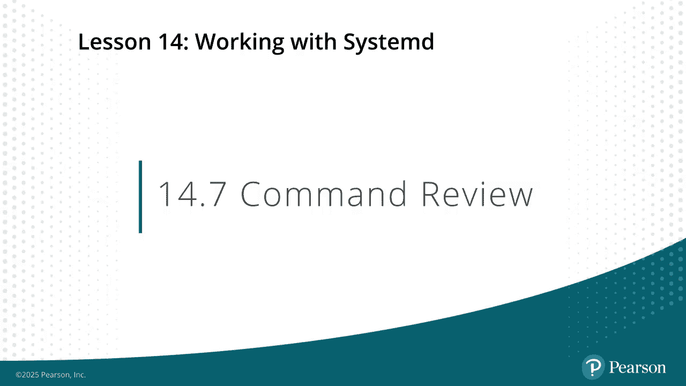
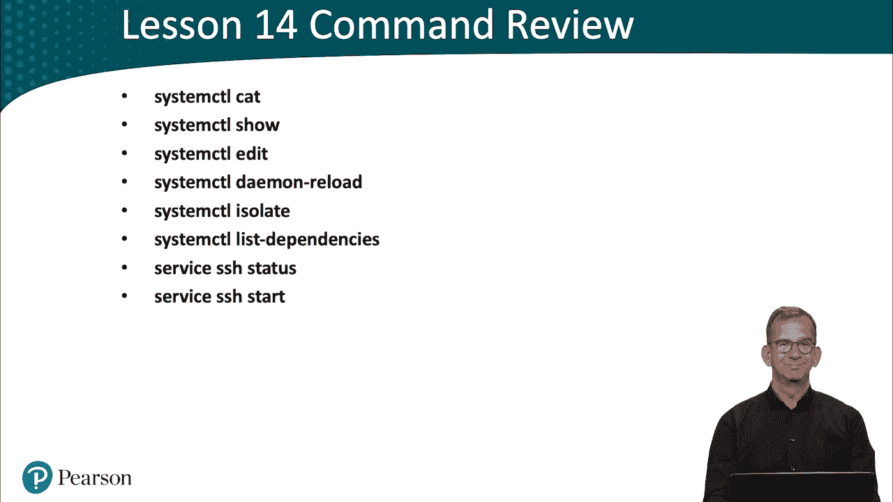

# CompTIA Linux+ V8：148：systemctl 命令复习 📋

在本节课中，我们将一起回顾之前学过的所有 systemctl 命令，并且也会简单介绍适用于旧系统的 service 命令。systemctl 是 Linux 系统中管理服务和单元的主要工具，掌握这些命令能让你更好地控制系统运行状态。不管是启动服务、查看状态，还是修改配置，都离不开这些命令。

先来看看最常用的启动和状态查看命令，这是日常管理中用得最多的操作。以下是相关命令的说明：

- `systemctl start <unit>`：用于启动一个单元。
- `systemctl status <unit>`：用于查看单元的当前状态信息。

学习完启动和状态查看之后，我们继续看看如何重启服务以及控制开机自启。当你修改了单元配置，这里说的不是单元文件本身，而是决定单元如何工作的配置内容，这时需要重启服务才能让新配置生效。以下是相关命令：

- `systemctl restart <unit>`：修改单元配置后使用，使新配置生效。
- `systemctl stop <unit>`：停止正在运行的单元。
- `systemctl enable <unit>`：将单元标记为开机自动启动。
- `systemctl disable <unit>`：确保开机时不会自动启动该单元。

了解了服务的启停和自启设置之后，接下来需要知道如何查看当前系统中加载了哪些单元，以及默认启动目标是什么。以下是查看命令：

- `systemctl list-units`：显示当前加载的所有单元。
- `systemctl get-default`：获取当前的默认目标。
- `systemctl set-default <target>`：设置当前的默认目标。

查看完单元列表和默认目标之后，我们再学习如何查看单元的详细配置和参数，以及如何安全地编辑配置。以下是配置相关命令：

- `systemctl cat <unit>`：推荐用于查看单元配置的方式。
- `systemctl show <unit>`：显示可用于调整单元的所有参数。
- `systemctl edit <unit>`：打开系统默认编辑器来编辑单元配置。
- `systemctl daemon-reload`：如果你直接修改了单元配置文件而没有使用 systemctl edit，则需要执行此命令重新加载配置（顺便说一句，直接修改配置文件不是推荐的做法）。

掌握了配置查看和编辑之后，我们继续看看在不同运行目标之间切换，以及查看单元之间依赖关系的方法。以下是相关命令：

- `systemctl isolate <target>`：从提供更多服务的目标切换到提供更少服务的目标，因为需要移除某些服务。
- `systemctl list-dependencies <unit>`：查看单元所有依赖关系的概览。

最后，我们来看看适用于不使用 systemd 的旧系统的 service 命令。以下是常见用法：

- `service <name> status`：获取服务的当前状态。
- `service <name> start`：启动指定服务。

本节课中，我们一起学习了 systemctl 的 start、status、restart、stop、enable、disable、list-units、get-default、set-default、cat、show、edit、daemon-reload、isolate 和 list-dependencies 等命令，同时也了解了传统 service 命令的基本用法。这些内容能够帮助你在 Linux 系统中有效地管理服务和单元。

