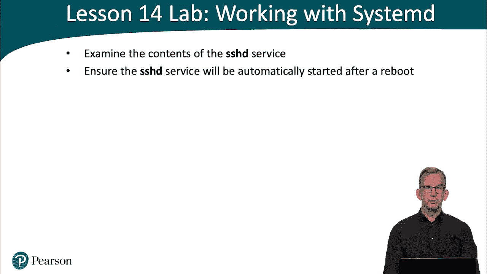
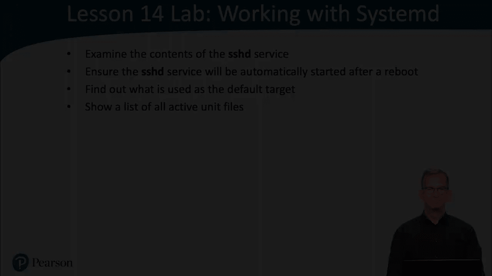

# 🐧 CompTIA Linux+ V8：14：使用 Systemd 进行服务管理实验


在本节课中我们将要学习如何使用 Linux 系统中的 Systemd 来管理服务。我们会通过一个简单的实验来操作 SSHD 服务，了解怎样查看服务内容，怎样设置开机自启，以及怎样查看默认目标和所有活跃的单元文件。这部分内容对初学者来说非常基础，大家可以跟着步骤一步一步来操作，不需要太多的先验知识，只要会使用终端就可以开始。


## 实验目标


上一节我们简单介绍了 Systemd 的基本概念，本节中我们来看看本实验具体要完成哪些任务。以下是本实验需要完成的几个主要步骤：

- 查看 SSHD 服务的详细内容
- 确保 SSHD 服务在系统重启后自动启动
- 查看系统当前使用的默认目标
- 列出系统中所有处于活跃状态的单元文件


## 查看 SSHD 服务内容


上一节我们列出了实验的整体步骤，本节中我们来看看如何查看 SSHD 服务的具体内容。SSHD 是 Linux 系统里提供远程登录功能的服务，Systemd 负责管理它的启动和停止。如果你想知道这个服务现在是不是运行着，或者它的配置文件在哪里，可以使用下面的命令来查看：

```bash
systemctl status sshd
```

这条命令会显示服务的当前状态，包括是否正在运行、最近的日志信息以及服务占用的资源情况。输出内容可能比较多，但你只需要关注最上面的几行，就能知道服务是正常运行还是出现了问题。


## 设置开机自启


上一节我们查看了 SSHD 服务的当前内容，本节中我们来看看怎样让它在系统重启之后自动启动。默认情况下，有些服务安装完成后并不会自动设置为开机启动，这意味着如果你重启了服务器，服务可能不会自己起来，你需要手动启动。为了避免这种情况，我们可以把服务设置为 enabled 状态：

```bash
systemctl enable sshd
```

执行这条命令之后，系统会在启动时自动启动 SSHD 服务。如果你想确认设置是否生效，可以使用下面的命令进行检查：

```bash
systemctl is-enabled sshd
```

如果输出结果是 enabled，就说明这项设置已经成功了，以后重启系统后 SSHD 会自动运行，不需要额外操作。


## 查看默认目标和活跃单元文件


上一节我们完成了 SSHD 服务的开机自启设置，本节中我们来看看系统默认使用什么目标，以及当前有哪些活跃的单元文件。默认目标决定了系统启动之后进入什么样的运行模式，比如是进入多用户命令行模式，还是进入带有图形界面的模式。单元文件则是 Systemd 管理的各种资源，包括服务、定时器、套接字等等。你可以使用下面的命令来查看默认目标：

```bash
systemctl get-default
```



如果你想查看当前系统中所有正在运行的服务类单元文件，可以使用下面的命令：

```bash
systemctl list-units --type=service --state=active
```



这条命令会列出所有状态为 active 的服务，包括服务名称、描述以及当前状态。通过这些命令，你可以更清楚地了解系统在运行时加载了哪些服务，默认的启动目标又是什么。


## 总结


本节课中我们一起学习了使用 Systemd 管理 SSHD 服务的方法。我们首先查看了 SSHD 服务的详细内容，然后设置了开机自启，接着确认了设置是否生效，最后查看了系统默认目标和所有活跃的单元文件。希望大家能够动手在自己的 Linux 系统上尝试这些命令，加深对 Systemd 的理解。

