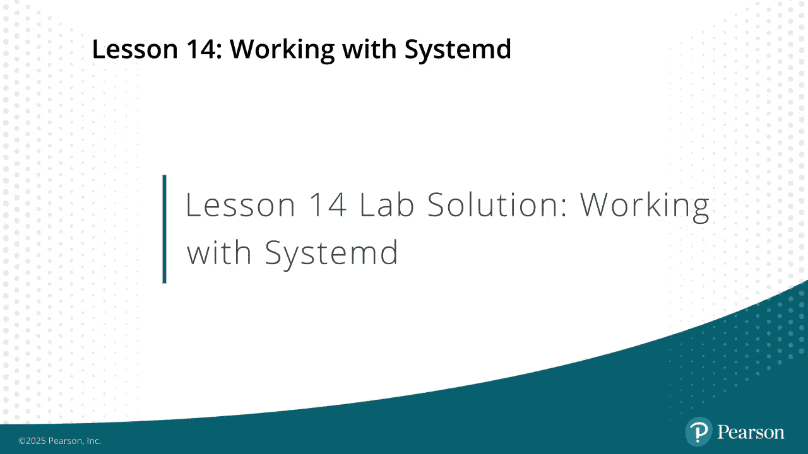
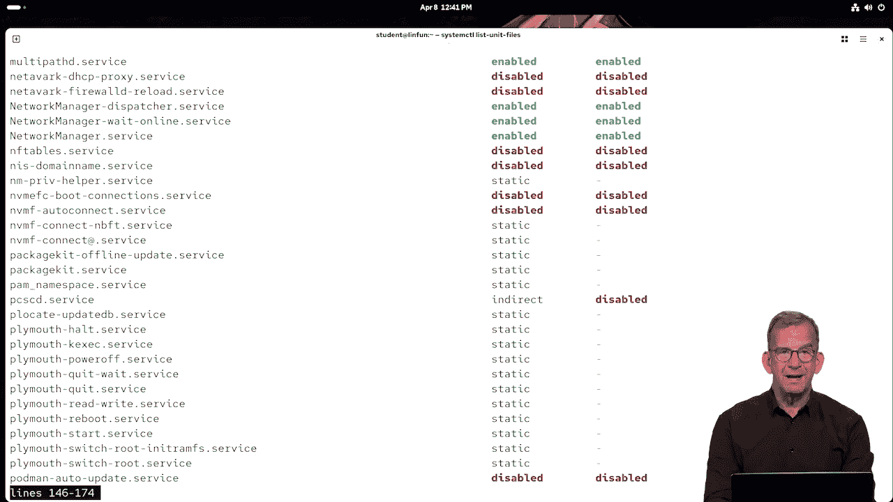

# O'Reilly CompTIA Linux+：Lesson 14：Systemd 服务管理实验解答 🖥️


在本节课中，我们将学习如何使用 systemctl 工具来管理 Linux 系统中的服务。课程内容主要围绕 SSHD 服务展开，包括如何查看服务当前运行状态、如何确保服务开机自动启动、如何查看和修改系统的默认运行目标，以及最后如何列出系统中当前活动的单元文件。所有内容都会用大白话讲解，适合完全没有 Systemd 基础的初学者跟随学习，不用担心看不懂专业术语。


## 一、查看 SSHD 服务状态




首先我们要了解 SSHD 服务现在是不是正常运行。以下是查看 SSHD 服务状态的具体做法。

在终端中直接执行下面这条命令即可。顺便说一句，即使你不使用 sudo 权限，systemctl status sshd 这个命令也能正常运行，不需要额外的管理员权限。

```bash
systemctl status sshd
```

执行之后，屏幕上会显示 SSHD 当前是 active 状态，并且正在 running 运行。输出信息里还会列出这个服务的 PID，也就是进程标识符，同时你可以看到它占用的内存并不算多，系统资源消耗比较低。这就是查看服务状态的第一步，确认服务是否存活以及运行得是否正常。


## 二、确保 SSHD 开机自动启动


上一节我们介绍了如何查看 SSHD 服务是否正在运行，本节中我们来看看如何确保它在系统启动时自动开始工作。

确保 SSHD 服务会自动启动，这在实际使用中非常重要，否则每次重启后你可能都需要手动去启动它。好消息是，在大多数系统里 SSHD 默认已经是 enabled 状态，也就是说它已经被设置为开机自启，我们不需要再做额外操作。

不过如果你发现它并没有启用，也不必担心，可以使用下面这条命令手动把它设置为开机自启。

```bash
sudo systemctl enable sshd
```

这条命令会把 SSHD 加入系统的启动列表，下次系统启动时它会自动跟着一起启动，不需要人工干预。


## 三、查看和修改系统默认 Target


刚才我们讨论了如何让 SSHD 开机自动启动，本节中我们来看看系统默认使用哪个运行目标，也就是 Target。

Systemd 把不同的运行模式称为 Target，你可以把它理解为系统的不同工作模式。要查看当前系统的默认 Target，可以使用 systemctl get-default 命令。执行之后你通常会看到 multi-user.target，这表示系统默认以多用户命令行模式运行，不启动图形界面。

这里有个小插曲，实验演示者提到自己忘记设置默认 Target 了，如果你也想把默认 Target 改成图形界面模式，可以使用下面这条命令把它设置回来。

```bash
systemctl get-default
sudo systemctl set-default graphical.target
```

执行 set-default 之后，系统下次启动时就会尝试进入图形界面模式。不过在本实验的末尾会出现一个提示信息，那只是说明系统之前是用别的方式启动的，完全可以安全忽略，不需要特别处理。


## 四、列出所有活动单元文件


前面我们学习了查看服务状态和设置默认 Target，最后一部分我们来看看如何列出系统中当前活动的单元文件。

在 Systemd 中，服务、挂载点、定时器等等都被称为单元（Unit）。如果你想查看系统里当前正在运行的东西，最常用的命令是 systemctl list-units。以下是这两个相关命令的对比说明。

- systemctl list-units：显示当前已加载并且处于 active 状态的所有单元，适合用来查看“现在到底在运行什么”。
- systemctl list-unit-files：显示更多的单元信息，不仅包括当前活动的，还包括那些虽然安装了但目前没有运行的单元。

如果你只想知道当前系统里有哪些服务在跑，那么 list-units 是更好的选择，因为它更聚焦于正在运行的内容；而 list-unit-files 虽然信息更全，但包含了很多不活跃的单元，看起来会比较杂。所以日常排查服务运行情况时，优先使用 list-units。

```bash
systemctl list-units
systemctl list-unit-files
```


## 五、本节总结




本节课中我们一起学习了如何使用 systemctl 管理系统服务。我们查看了 SSHD 服务的运行状态，确认了它是否开机自启，学习了如何查看和修改系统默认 Target，最后还对比了 list-units 和 list-unit-files 两个命令，了解了什么情况下该用哪个。希望这些内容能帮助你更好地理解 Systemd 的基本使用方法。


