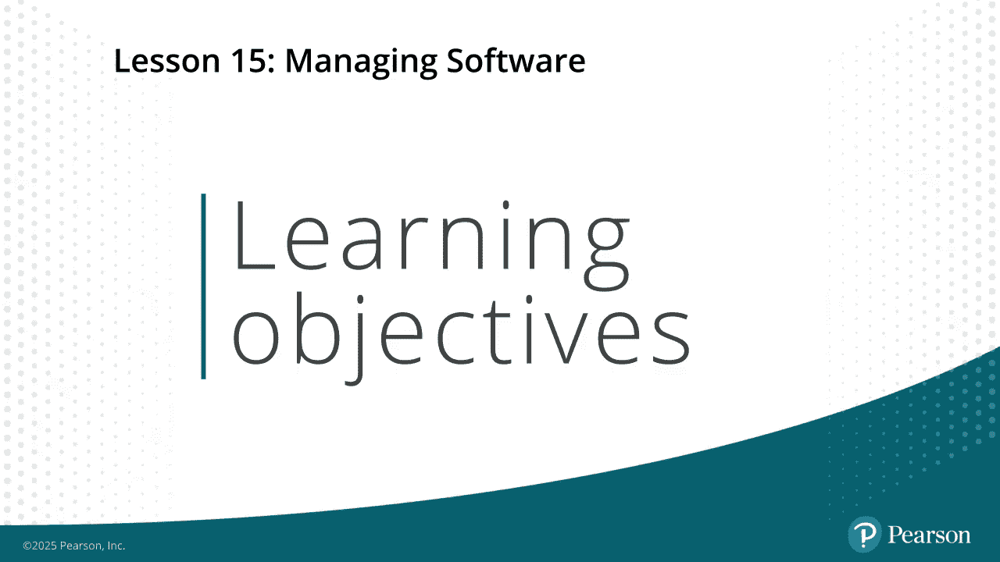
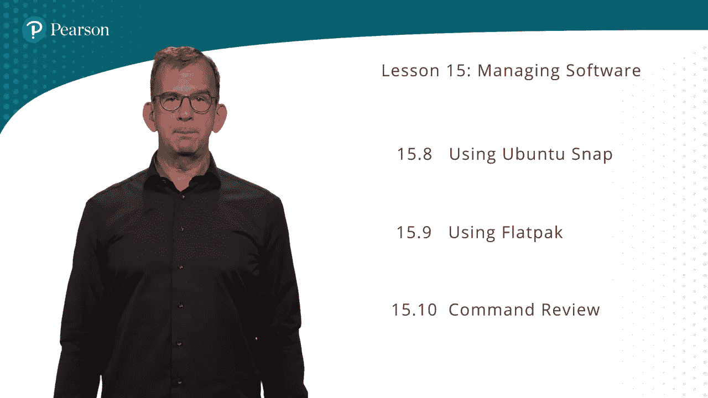
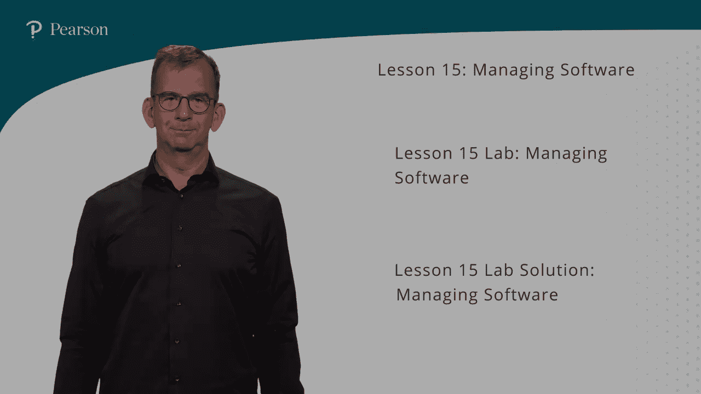

# CompTIA Linux+ V8：第151课：学习目标 🐧


欢迎来到 Man So。在 Linux 系统中，安装和管理软件有很多种不同的选择。本节课程会先给你一个总体的概览，让你先知道大概的方向。接下来，老师会把所有不同的安装和管理选项逐一讲清楚，起点是从源代码安装软件。后面会接着介绍软件包和依赖关系，然后教你怎么用 DF、YM、Redt 等工具来管理软件包，也会讲 Ubuntu 上的应用程序管理。之后，课程里会有两个视频专门讲高级的软件管理工具，分别是 Ubuntu 上的 Snap 和 Red Hat 上的 Flatpak。最后，在课程的实验环节，你会亲手练习操作软件。无论你是刚接触 Linux 的新手，还是想要系统复习的学习者，这节课都会帮你建立起清晰的知识框架。


## 课程整体安排




上一节我们简单说了欢迎词和 Linux 软件管理的基本情况，本节中我们来看看本节课的具体安排。老师会先给你一个大致的介绍，让你对 Linux 软件管理有个初步印象。


以下是本节课的主要内容列表：
- Linux 软件安装和管理的多种选项
- 课程从总体概览开始，再逐个展开所有不同选项
- 从从源代码安装软件作为起点


## 从源代码安装软件


刚才我们介绍了课程的整体安排，本节中我们来看看第一个具体安装方式。在 Linux 里面，有一种安装软件的方法是直接使用源代码。所谓源代码，就是程序员写出来的、人类能够看懂的文本文件。你要把这些文本编译成计算机能运行的二进制文件，然后才能安装使用。虽然步骤比直接安装软件包要多一些，但这种方式能让你更清楚软件是怎么运行的。


源码安装的核心步骤可以用这个简单的公式表示：

```text
源代码 -> 编译 -> 安装 -> 可运行软件
```

使用源码安装时，你需要先下载程序的源代码，然后在自己的系统上进行编译，最后把编译好的文件放到系统目录中。虽然过程稍微麻烦一点，但对理解 Linux 软件很有帮助。


## 软件包和依赖关系


上一节我们介绍了从源代码安装软件，本节中我们来看看软件包和依赖关系。在 Linux 中，软件通常不以单一文件形式存在，而是被打包成软件包，方便分发和安装。


以下是关于软件包和依赖的关键点：
- 软件包是打包好的程序文件集合
- 依赖关系指一个软件运行需要其他软件库或组件支持
- 后续视频会详细解释软件包和依赖是如何工作的

当你安装一个软件包时，系统可能会检查它是否需要其他包才能正常运行，这些就是依赖项。如果缺少依赖，软件可能无法安装或者打不开。理解依赖关系能帮你避免安装失败的问题。


## 常用包管理工具


刚才我们讲了软件包和依赖关系，本节中我们来看看如何使用包管理工具。不同的 Linux 发行版自带不同的包管理器，常见的有 DNF、YM、Redt 等工具，以及 Ubuntu 上的应用管理工具。


以下是各发行版常用的包管理工具对照：
- DNF：用于较新的 Red Hat 系系统
- YM：用于较旧的 Red Hat 系系统
- Redt：Red Hat 系相关管理工具
- Ubuntu 上的应用管理工具

这些工具能帮你自动下载软件包、处理依赖关系，并完成安装、升级和删除操作。使用包管理器比手动编译源码要简单得多，也更安全。


## 高级软件管理工具


上一节我们介绍了传统的包管理工具，本节中我们来看看更高级的软件管理方式。除了常规的包管理器，Linux 还支持一些现代的通用软件包格式，例如 Snap 和 Flatpak。


以下是高级软件管理工具的介绍：
- Snap：主要用于 Ubuntu 系统
- Flatpak：主要用于 Red Hat 系系统

这些工具可以跨发行版运行软件，并且通常自带所有依赖，安装起来更加方便。如果你需要在不同 Linux 发行版之间共享软件，它们会是很好的选择。


## 课程实践练习


刚才我们介绍了高级软件管理工具，本节中我们来看看课程的最后部分。在学完所有理论内容后，你会有机会动手实践软件管理操作。




课程末尾的实践环节包括：
- 在实际系统中安装和管理软件
- 使用不同的包管理工具完成常见任务
- 体验 Snap 和 Flatpak 等高级工具

通过动手操作，你可以把刚才学到的知识变成真正的技能，为后续的学习打下坚实基础。




## 本节总结


以上就是本节课的全部内容了。本节课中，我们一起学习了 Linux 软件安装和管理的学习目标。我们知道了 Linux 有很多软件安装和管理选项，课程从概览开始，先讲从源代码安装软件，再讲软件包和依赖关系，接着讲 DNF、YM、Redt 和 Ubuntu 上的应用管理，然后介绍 Snap 和 Flatpak 等高级软件管理工具，最后安排实践练习。希望这些内容能帮你建立起对 Linux 软件管理的整体认识。
