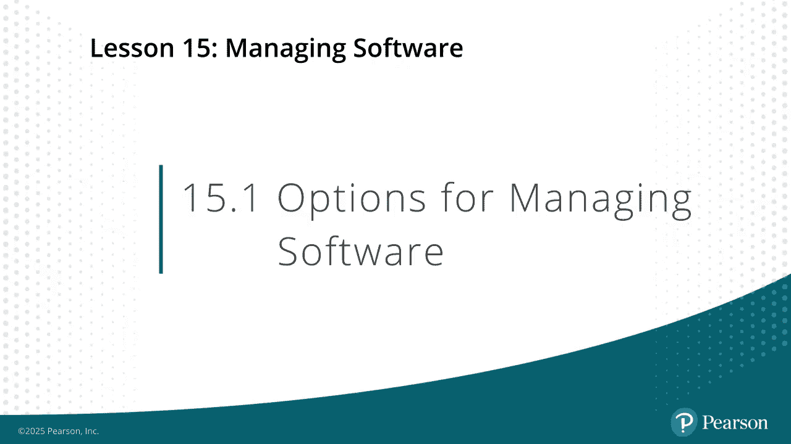
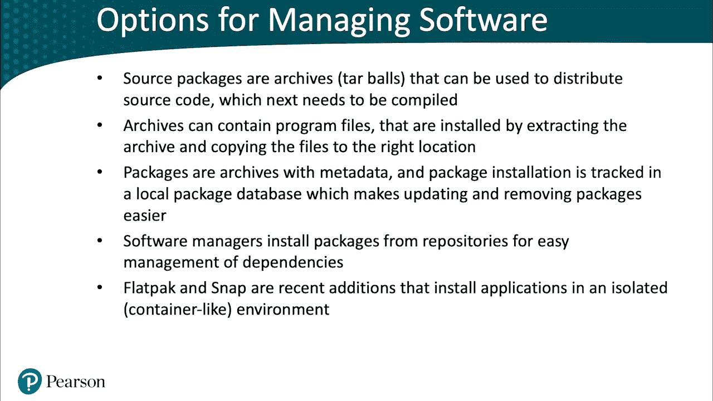

# CompTIA Linux+ V8：152：Linux 软件管理的几种常见方式📦


## 开篇概述 📖


在本节课中我们将要学习 Linux 系统上安装和管理软件的不同方式。如果你是刚接触 Linux 的新手，可能会觉得在 Windows 里双击安装程序很简单，而在 Linux 里好像有好几条路径可选，这很正常。本节课会把这些方法从最基础到最现代逐一讲清楚，帮助你建立起整体的认知框架，为后面深入学习包管理器打下基础。不必担心一开始觉得内容多，我们会用大白话把每一个概念都拆开来讲。




## 为什么 Linux 上有多种安装软件的方法？

上一节我们介绍了 Linux 系统的基本操作，本节中我们来看看在 Linux 系统里，软件到底是怎么被安装和管理的。

当你在 Linux 系统中工作时，会发现管理软件并不只有一种固定的做法。不同的发行版、不同的应用场景，可能会采用不同的安装手段。这种多样性看起来有点复杂，但实际上每种方式都有它适用的场合，了解这些差异能帮你在日常运维中做出更合适的选择。

以下是 Linux 上常见的软件管理方式：
- 使用源码包进行编译安装。
- 直接解压归档文件并复制程序文件。
- 使用标准软件包和包管理器。
- 使用 Flatpak 或 Snap 等现代容器化格式。


## 最原始的方法：源码包与编译

刚才我们概览了几种主要方式，本节中我们先从最基础、也最底层的方法说起，也就是源码包。

最根本的方式是使用源码包。这里的源码包通常是归档文件，最常见的就是 tarballs，也就是由 tar 工具创建的归档文件，常见的后缀是 .tar.gz 或 .tar.bz2，用来分发程序的源代码。既然拿到的是源代码，计算机不能直接运行，你就需要把它编译成机器能看懂的二进制程序。幸运的是，现在的桌面用户很少需要手动这么做，大多数常用软件都有现成的安装包了。

源码包安装的典型步骤可以用下面的代码来表示：
```bash
tar -xvf 软件名称.tar.gz
cd 软件名称
./configure
make
sudo make install
```

核心关系可以用简单的公式描述：
源码包 = 压缩的源代码文件 + 构建说明


## 另一种简单方法：直接解压归档文件

除了编译源码，还有一种不需要编译的归档文件使用方式，本节中我们来看看这种方法的具体操作和局限。

另一种选择是直接使用归档文件。这种归档包含已经编译好的程序文件，安装过程就是把归档解压，然后把文件复制到系统的合适位置。这种方法确实可以让程序运行起来，但并不十分方便。因为一旦你想要升级软件，或者把它卸载掉，系统并没有记录这些文件到底放在了哪里，你可能需要手动一个一个地找出来删除，工作量会很大。

以下是直接解压安装的优缺点：
- 优点：不需要编译，解压即可使用。
- 缺点：没有安装记录，升级和删除都很麻烦。


## Linux 的标准做法：软件包与包管理器

正因为手动管理文件太麻烦，Linux 社区逐渐形成了更标准的做法，本节中我们来看看什么是软件包和包管理器。

这就是为什么在 Linux 系统上，标准做法是使用软件包。软件包本质上也是归档文件，但它里面除了程序文件，还包含元数据，比如软件名称、版本号、依赖关系等信息。当你安装软件包时，系统会把这些信息严格地记录在本地的包数据库里。有了这个数据库，以后想要升级或者删除软件，包管理器就能精准地知道哪些文件属于这个软件，操作就简单多了。

软件包的组成结构可以表示为：
```
软件包 = 程序文件 + 元数据（名称、版本、依赖等）
```

软件包管理器运行在这些软件包的基础之上，它们会从软件仓库中下载并安装软件包。软件仓库是在线资源，里面收集了大量的软件包，供用户方便地获取。使用仓库最大的好处是能轻松处理依赖关系，也就是当一个程序需要另一个程序才能运行时，包管理器会自动帮你把所需的组件都装好。

以下是软件包管理方式的主要特点：
- 元数据记录在本地包数据库中。
- 支持从在线仓库批量安装软件。
- 自动处理软件之间的依赖关系。
- 升级和删除软件都非常方便。


## 新时代的选择：Flatpak 与 Snap

传统的包管理器解决了大部分问题，但近年来又出现了两种新的格式，本节中我们来看看 Flatpak 和 Snap 是怎么工作的。

在 Linux 软件安装方式的最新发展中，出现了 Flatpak 和 Snap。这两种是最近才加入的技术，它们的核心思想是把应用程序安装在一种隔离的、类容器的环境里。也就是说，应用及其所需的依赖被打包在一起，与系统其他部分相对独立，这样可以减少冲突，也让跨发行版发布软件变得更容易。

Flatpak 和 Snap 的核心特征可以用代码块概括：
```text
应用运行环境 = 隔离的类容器沙箱
依赖处理 = 随应用一起打包，减少对系统库的依赖
```


## 接下来要学什么？

到此我们已经了解了 Linux 上所有主要的软件管理方式，本节中我们来看看接下来的学习重点。

在接下来的几个视频中，你将会更深入地学习每一种方法的具体操作，尤其是传统包管理器的实际使用和命令。掌握这些内容之后，你会对 Linux 软件管理有非常完整的认识。


## 课程总结 📚



本节课中我们一起学习了 Linux 系统上管理软件的几种常见方式。我们从最基础的源码包和编译开始，讲解了直接解压归档文件的方法，重点介绍了带有元数据的标准软件包和包管理器，最后也提到了 Flatpak 和 Snap 等新兴的容器化安装格式。希望这些内容能帮你理清 Linux 软件安装的全貌，为后续的学习打下坚实基础。

