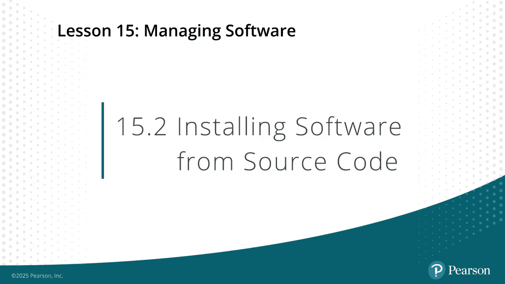
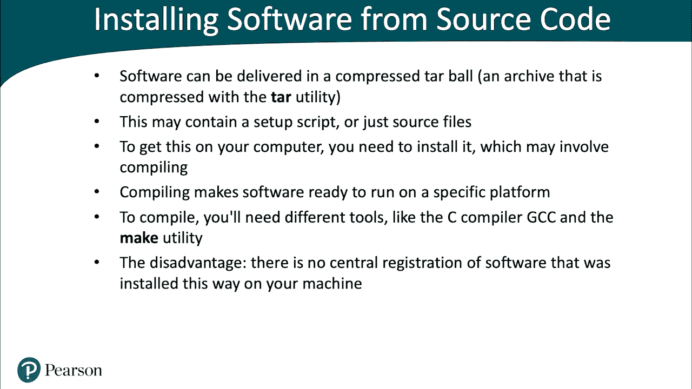

# CompTIA Linux+ V8：152：从源代码安装软件 📦

在本节课中，我们将一起学习如何从源代码安装软件。你将了解什么是压缩归档文件，如何解压并查看其中的内容，以及什么是软件编译。此外，我们还会讨论这种安装方式的缺点，并解释为什么现在已经不那么常见了。通过本节内容，你可以对 Linux 上的软件安装有一个更完整的认识。

什么是压缩归档文件

在 Linux 系统中，安装软件的一种常见方式是使用经过压缩的归档文件。这种文件通常由 tar 工具生成，它把很多文件打包在一起，并且经过了压缩处理，这样就方便在网络上传输和在本地保存。

当你拿到这样一个文件之后，首先需要做的就是把它解压出来。解压完成后，你不能立即使用软件，还需要查看里面到底包含什么内容。里面可能是一个安装脚本，也可能是源代码文件，或者是其他类型的文件。

以下是你可能会在解压后看到的常见内容类型：

- 安装脚本：运行后即可开始安装流程。
- 源代码文件：需要经过编译才能在系统中运行。
- 说明文档：提供具体的安装步骤和注意事项。

在实际操作之前，最好的做法是先检查是否存在 README 文件，因为里面通常会给出更具体、更针对该软件的安装说明。

了解了归档文件及其内容之后，接下来我们来看看解压后的源代码该如何处理。

软件编译的基本原理

解压出来之后，如果里面是源代码，你就需要把软件安装到计算机中。这个过程可能还涉及编译。编译的作用是将源代码转换成可以在特定平台上运行的程序，让软件准备好执行。

因为 Linux 是开源系统，在 Linux 上进行编译非常普遍。源代码以通用方式编写，经过编译后就能在你的平台上正常工作，无论你的具体硬件环境是什么。

编译过程需要用到一些开发工具，其中最常见的是 C 编译器 GCC 和 make 实用工具。它们的作用关系可以用下面这个简单公式表示：

$$ \text{源代码} + \text{GCC} + \text{make} \rightarrow \text{可运行程序} $$

不过，编译软件也是一项相当繁琐的工作，你需要准备好不同的工具，并且花费一定的时间和精力才能完成整个安装过程。

掌握了编译原理之后，我们也需要了解这种安装方式的不足之处。

从源代码安装的缺点与现状

虽然从源代码安装软件可行，但这种方法也有明显的不足。最大的问题是，计算机中没有一个统一的中心或登记表来记录通过这种方式安装的软件，这会导致后期管理、升级或卸载变得比较麻烦。

幸运的是，随着软件包管理器的普及，这种安装方式正在变得越来越少见。因此，本节课程不会进行具体的演示，接下来我们将重点介绍通过软件包来安装软件的方法。

总结

本节课中，我们一起学习了从源代码安装软件的相关内容。我们了解了什么是由 tar 工具压缩的归档文件，知道解压后需要查看内部包含的安装脚本、源代码或说明文件，并掌握了编译可以让通用源代码在特定平台上运行的基本原理，同时也认识到这种方式缺乏集中登记且使用频率正在降低。希望这些知识能帮助你更好地理解 Linux 上的软件安装流程。

