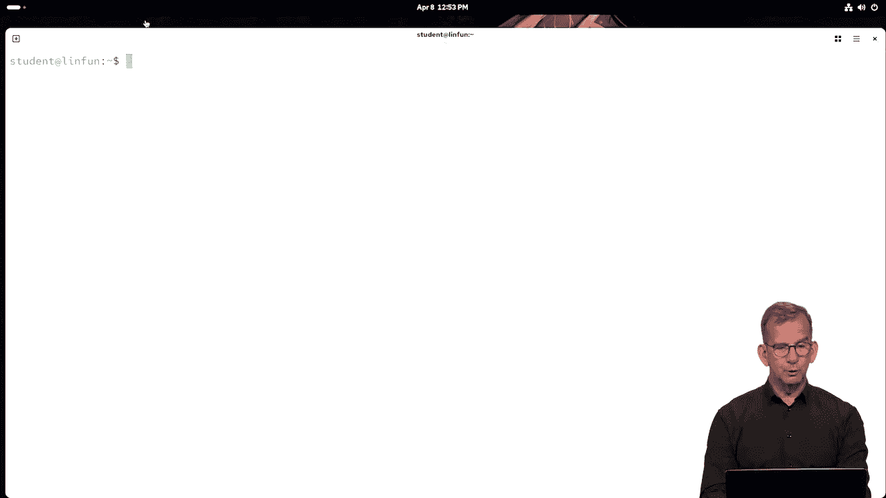
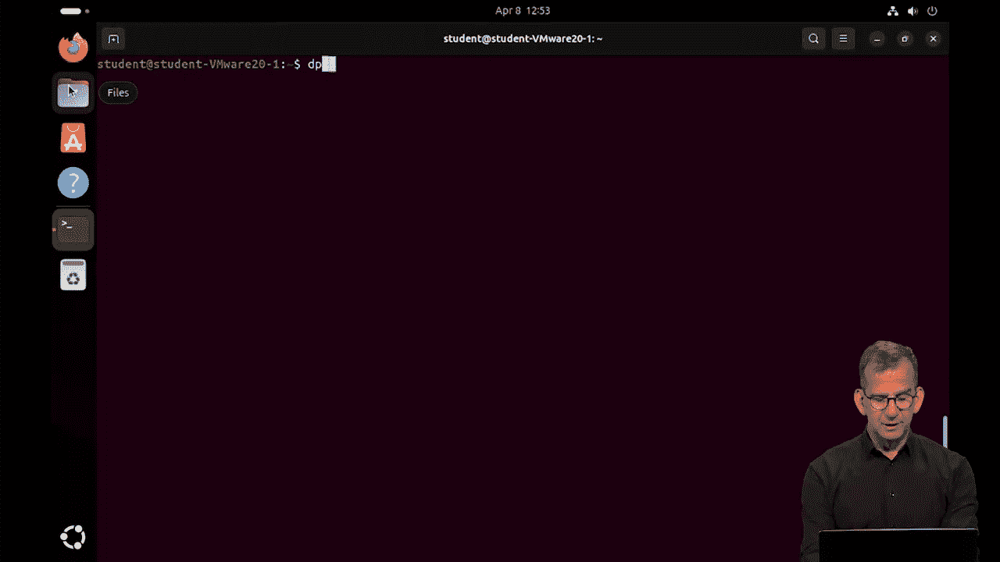

# CompTIA Linux+ V8：153：理解软件包 📦

在本节课中，我们将要学习 Linux 系统里的软件包是什么，它们是如何工作的，以及常见的包格式有哪些。通过这节课的内容，你将能够理解系统中已安装软件的来源，并且掌握查看和管理软件包的基本方法。我们会用大白话把每个概念讲清楚，让初学者也能快速上手。

什么是软件包

首先，我们来看看软件包到底是什么东西。软件包可以理解为一个专门用来安装软件的“打包文件”。它里面不仅包含程序本身的文件，还附带一段安装脚本，这段脚本负责把文件复制到系统中正确的位置。除此之外，软件包还会配套一个数据库，用来记录当前系统里到底安装了哪些软件，这样系统才能清楚每个文件属于哪个包。

通常情况下，一个软件包主要关注它自己想要安装的软件。下面是软件包的基本组成说明：

- 程序文件：实际运行的软件代码和资源文件。
- 安装脚本：负责把文件放到正确位置的脚本。
- 数据库记录：记录已安装包的信息，方便系统查询和管理。

你也可以用下面这个简单的公式来理解软件包的构成：

`软件包 = 程序文件 + 安装脚本 + 数据库记录`

软件包之间的依赖关系

有了这些基本组成之后，我们还需要了解软件包之间的关系。在 Linux 系统中，软件包很少是孤立存在的。很多软件为了正常运行，依赖于其他软件包提供的功能或库文件。这种关系就是依赖关系。简单来说，如果你想安装某个包，而这个包又需要另一个包才能工作，那么系统就需要先安装那个被依赖的包。

依赖关系可以用下面这个公式表示：

`包 A 依赖包 B → 必须先安装包 B，才能安装包 A`

这意味着，在你安装某个软件包之前，或者在安装过程中，系统需要确保相关的依赖包已经就位。如果缺少依赖，软件可能无法正常安装，或者安装后也无法运行。这就是为什么我们在处理软件包时，不能只盯着单个包，还要考虑它周围的相关包。

RPM 包格式与查询命令

接着，我们来看看 Red Hat 系系统中使用的软件包格式。在 Red Hat 及其衍生系统中，RPM 是标准的软件包格式。RPM 包的全称是 Red Hat Package Manager，它定义了软件包如何组织、如何安装以及如何记录信息。如果你使用的是 Red Hat、CentOS 或 Fedora 等系统，那么你遇到的大部分软件包都会是 RPM 格式。

接下来我们来看看如何查询系统中已安装的 RPM 包。你可以使用下面几个命令来完成这个任务：

- `rpm -qa`：列出 RPM 数据库中当前所有已安装的包。
- `rpm -qa | grep 包名`：在所有已安装包中查找指定名称的包。
- `rpm -ql 包名`：显示某个已安装包中包含的所有文件列表。

当你执行 `rpm -qa` 时，系统会遍历 RPM 数据库，把所有已安装的包名打印出来。如果你只想确认某个特定的包是否存在，可以把结果通过管道传给 `grep` 命令进行过滤，比如 `rpm -qa | grep Mmap` 就能显示相关包是否已经安装。而当你想了解一个包到底把哪些文件放到了系统里时，就可以用 `rpm -ql` 来查看该包的文件清单，它会给出包中所有文件的完整列表。

Ubuntu 与 dpkg 包格式

虽然 RPM 在 Red Hat 系系统中很常见，但其他发行版有自己的标准。接下来，我们把目光转向 Ubuntu 系系统。在 Ubuntu 等 Debian 系系统中，标准的包格式是 deb 包，而对应的管理工具叫做 dpkg。dpkg 是 Debian Package 的缩写，它承担着与 RPM 类似的职责，即负责 deb 包的安装、查询和管理。

在 Ubuntu 上，你可以使用下面这个命令来查看已安装的包：

- `dpkg -l`：显示系统中所有已安装的 deb 包列表。

这条命令的作用其实和 `rpm -qa` 很相似，都是去检查本地的包数据库，然后列出当前系统里安装了哪些软件包。通过这种方式，你可以快速了解系统软件清单，也方便排查软件冲突或缺失的问题。这也正是检查包数据库、找出已安装包的最直接方法。

不要过度关注单个包，要关注包管理器

前面我们介绍了 rpm 和 dpkg 等底层工具，可以用来查看单个包的详细信息。不过，在现代 Linux 系统中，直接一个个操作这些包并不是最推荐的做法。虽然了解这些命令很有帮助，但真正的重点在于包管理器。

包管理器，比如 yum、dnf 或 apt，能够自动处理依赖关系，帮你自动下载和安装所需的相关包，而不需要你手动去寻找每一个依赖项。所以说，不要太担心单个软件包的细节，更要关注包管理器的使用，因为它们才是我们日常管理软件的主力工具。

本节课总结

本节课中，我们一起学习了软件包的基本概念，了解了包内部包含程序文件、安装脚本和数据库记录。我们也讨论了软件包之间的依赖关系，并分别介绍了 Red Hat 系系统中的 RPM 格式与 Ubuntu 系系统中的 deb 格式。此外，我们还学习了使用 `rpm -qa`、`rpm -ql` 和 `dpkg -l` 等命令来查询已安装的包，最后强调了在实际工作中应该更多地关注包管理器，而不是直接操作单个软件包。
