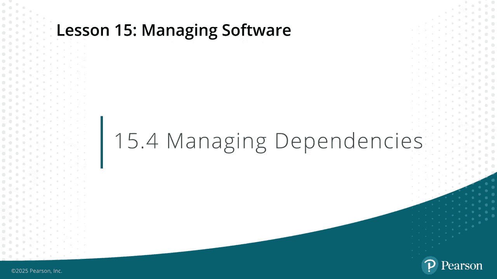
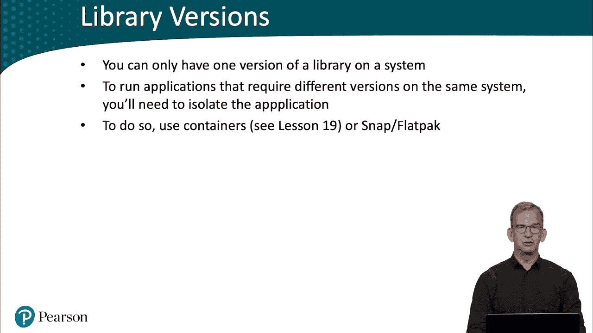
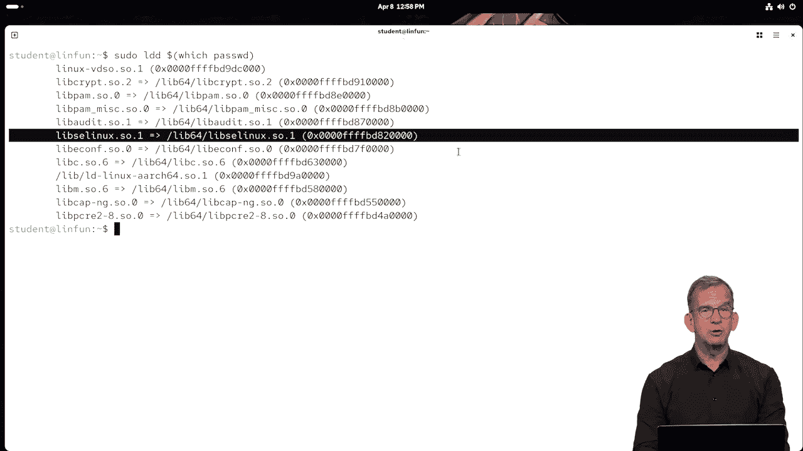

# CompTIA Linux+ V8：154：管理依赖关系 📦

在本节课中，我们将一起学习Linux系统中的依赖关系是如何工作的。依赖关系看起来可能比较复杂，但实际上它只是软件之间相互依赖的一种机制。我们会先解释什么是依赖关系，然后看看包管理器如何帮我们处理这些问题，最后通过一个实际的命令演示来查看系统中安装了哪些库。

上一节课我们介绍了软件包的基本概念，本节中我们来看看依赖关系到底是什么，以及它在日常使用中扮演什么角色。

依赖关系通常是为应用程序提供通用功能的库。很多程序并不包含所有功能，而是依赖外部的共享库来完成某些工作。还存在其他类型的依赖关系。例如，如果你想要运行一段Python脚本，那么系统中必须预先安装Python，否则脚本无法正常执行。

依赖关系始终以独立管理的软件包形式提供。这意味着每个库都有自己独立的安装和更新流程。这种方式可能会变得相当复杂，因为你需要确保所有需要的库都存在，并且版本正确。不过幸运的是，DNF等包管理器提供了相应的解决方案，可以自动帮你处理好这些依赖关系，免去手动查找和安装的麻烦。

关于这些库，在Linux系统中，库被广泛使用，目的是让使用软件变得更加容易。这是因为库提供了多个软件包可能共同使用的通用功能。例如，如果你想要分析网络数据包，就会用到名为libpcap的数据包捕获库。还存在libc，这是一个更常见的库。这是Linux操作系统中提供所有通用函数的C库。你会发现它成为你使用的所有软件包的依赖关系。几乎每个程序在运行时都需要调用libc中的某些基础函数。

安装软件包时，库会作为依赖关系一起安装。你可以使用`ldd`命令来查看系统中当前安装了哪些库。在使用库的过程中，会出现库版本的问题。在一个系统中，同一个库只能安装一个版本。可以用下面这个简单的公式来描述这个规则：
`系统中某个库的版本数量 = 1`
这带来了一个实际难题，即如果你想要在同一台系统中运行需要同一个库不同版本的应用程序，该如何解决呢。

这时你需要隔离应用程序。有两种方法可以使用隔离。以下是常见的隔离方案：
- 将应用程序作为容器运行，我们将在第十九课中详细讨论容器技术。
- 在其他发行版中使用Snap或Flatpak来创建隔离的应用程序，这样不同版本的库可以分别被不同的应用程序使用。

在进一步讨论包管理器之前，我们先快速查看一下这些库在实际系统中的样子。如果你想要了解库的相关信息，我将使用`ldd`命令。我将对`which passwd`命令的结果执行此操作。请记住，如果将这样的命令放在反引号和括号中，你将处理该命令的执行结果，而不是命令本身。

我们可以看到什么呢，我们可以看到所有的库，包括C库`libc.so.6`。还可以看到其他定义命令工作方式的库，例如`libpam`。`libpam`是可插拔认证模块，是一个用于认证的框架。还有`libaudit`，这意味着你可以审计该实用工具在Linux系统中生成的消息。因为这是RHEL系统，SELinux被用于提供更多安全性，所以审计功能显得尤为重要。

关于这些库的问题是，它们在安装软件包时都需要被安装。在下一节视频中，你将了解这具体是如何工作的，以及包管理器如何自动完成这个过程。

在本节课中，我们一起学习了依赖关系的基本概念、库在Linux中的作用、版本冲突带来的挑战，以及隔离应用程序的两种常见方法。我们还通过`ldd`命令实际查看了`passwd`命令所依赖的库，包括libc、libpam和libaudit等。希望这些内容能帮助你更好地理解Linux系统中软件包和库之间的关系。

