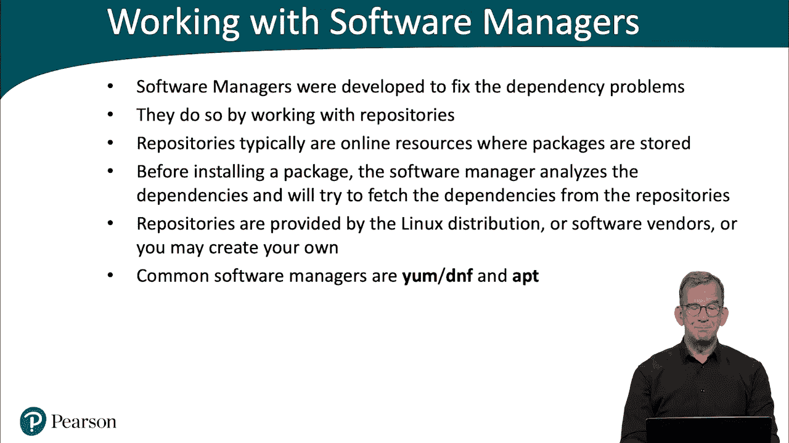
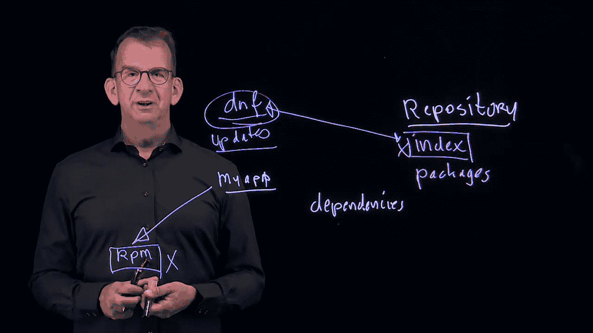

# 📦 CompTIA Linux+ V8：155：理解软件管理器

## 本节概述

在这节课中，我们将一起学习什么是软件管理器，也叫包管理器，以及它是如何解决 Linux 系统中安装软件时的依赖问题的。你将了解软件仓库的作用，明白依赖关系是如何被自动处理的，还会看到本地数据库在其中扮演什么角色。不管你之前是否接触过 RPM 或 apt 之类的命令，这节课都会用大白话把原理讲清楚，让你对 Linux 软件管理有直观的认识。

## 🔧 软件管理器为什么会出现

在了解具体怎么用之前，我们先来看看为什么会出现这种工具。早期的 Linux 系统里，安装软件并不像现在这么方便。如果你想装一个应用程序，可能需要手动运行 RPM 之类的命令。系统一旦发现缺少依赖项，就会报错提示你。这时候你得去找那些缺失的依赖，结果发现这些依赖项本身可能还依赖其他东西，这样一层套一层，很容易就花掉整个下午，还不一定能让程序跑起来。这种情况被称作“依赖地狱”，正是为了摆脱这种混乱，软件管理器才被开发出来。

早期的安装流程可以用下面这个简单的伪代码来表示：
```
手动安装 RPM 包 → 系统提示缺少依赖 → 手动寻找依赖 → 依赖项仍有依赖 → 浪费大量时间
```

## 📦 软件仓库与自动依赖解决

有了软件管理器之后，问题就好处理多了，关键在于它和软件仓库的配合。软件仓库可以理解为一个存放大量软件包的在线资源。不同的 Linux 发行版或软件厂商会提供自己的仓库，你也可以自己搭建一个。仓库里除了软件包本身，还有一个非常重要的东西叫索引。这个索引会随着新软件包的加入而不断更新，记录下每个包的版本和依赖信息。



当你准备安装一个软件包时，软件管理器会先分析这个包需要哪些依赖，然后尝试直接从仓库把这些依赖一起抓下来。这样一来，依赖需求就能自动解决，你不需要再一个一个地手动去找了。

下面列出几种常见的软件管理工具：
- Red Hat 系发行版：DNF（YUM 也是常见选择）
- Ubuntu 相关系统：apt

不同工具的具体命令可能有差异，但处理依赖的基本原理是一样的。

## ⚙️ 软件管理器的工作流程

接下来，我们来看看软件管理器在你的本地系统上是怎么运作的。在你的电脑上，会有一个仓库客户端，比如 DNF。当你用它安装软件包时，第一步是获取最新的仓库索引。你可能会觉得从网上同步索引有时候有点慢，那是因为客户端在检查索引是否有变化，如果有更新就会下载下来。DNF 需要这个最新索引，才能知道当前有哪些可用的更新。

假设你要安装一个名为 my-app 的软件包，DNF 会分析它的依赖关系。如果发现需要额外的依赖项，这些依赖项也会自动从仓库获取并安装。这样一来，仓库就是解决依赖问题的方案，安装过程对你来说就变得简单很多了。

安装软件包的命令示例如下：
```
$ dnf install my-app
```

## 💾 本地数据库与软件更新

软件包安装完成后，软件管理器的工作还没有结束，它还会把相关信息记录在本地。对于基于 RPM 的系统，安装好的软件包会被登记在一个名为 RPM 数据库的本地数据库里。你可以查询这个数据库，搞清楚系统上到底装了哪些软件。当你再次使用 DNF 安装或更新软件包时，管理器会把仓库的索引和你本地数据库里的软件包进行对比，从而判断是否需要更新，并把可用的更新安装上去。

查询本地已安装软件包的命令示例如下：
```
$ rpm -qa
```

## 本节总结



在这节课中，我们一起学习了软件管理器（包管理器）的基本概念和作用。我们了解到，早期的手动安装方式容易陷入“依赖地狱”，而软件管理器通过与软件仓库协作，能够自动分析并获取依赖项，极大地简化了软件安装。我们还认识了常见的工具，比如 Red Hat 系的 DNF 和 Ubuntu 系的 apt，并看到了本地数据库（如 RPM 数据库）在记录已安装软件、辅助更新检查中的作用。希望这节课能帮你建立起对 Linux 软件管理的直观认识，为后续的实操打下基础。
