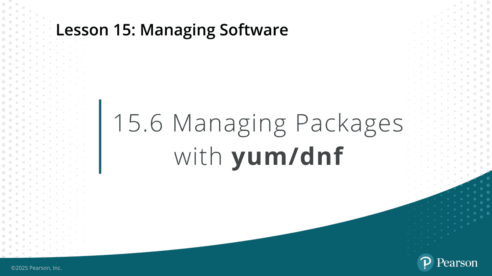
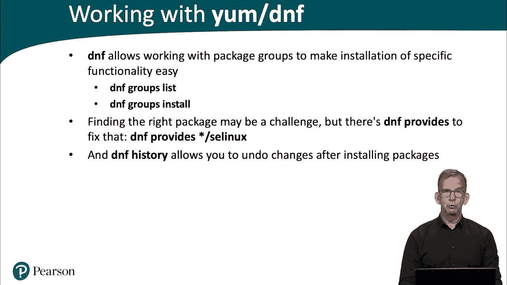
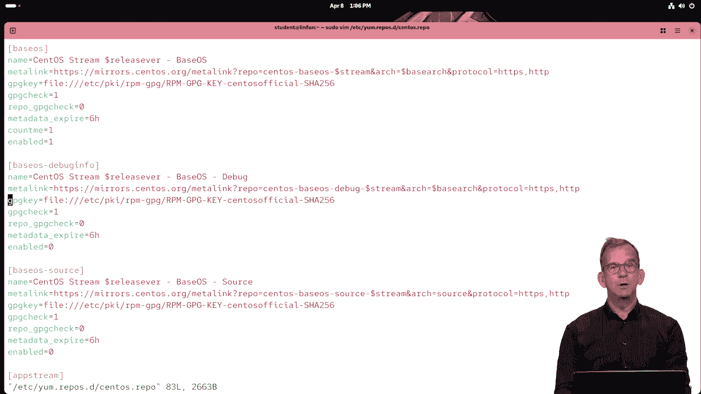

# CompTIA Linux+ V8：156：使用 Yum 和 DNF 管理软件包 📦




## 概述

在本节课中，我们将要学习在 Red Hat 系列系统里如何使用 Yum 和 DNF 来管理软件包。内容包括 Yum 和 DNF 之间的关系，DNF 在新版系统中的地位，以及实际操作中如何搜索、安装、列出、更新和删除软件包。我们还会看看怎么管理软件包组，怎么查找包含特定文件的软件包，以及怎么查看系统上的软件仓库。


## 一、Yum 与 DNF 的演变

Red Hat 系列系统以前一直依赖 Yum 来处理软件包安装和更新。最近，Yum 的后端被 DNF 取代了。在目前的系统版本中，DNF 已经成为了首选工具。

随着 RHEL 10 的发布，DNF 推出了一个新版本。这个新版本不再兼容旧版的 Yum。在 RHEL 9 及之前的系统里，如果你愿意，还可以继续使用 Yum；但在 RHEL 10 及以后的版本中，使用 DNF 变得非常重要。


## 二、DNF 的仓库与命令设计

DNF 使用的软件仓库配置保存在 `/etc/yum.repos.d/` 目录中。DNF 命令的设计目标是让人一看就懂，常见的操作命令包括 `dnf search` 和 `dnf remove`，命令名称本身就能大致说明它的作用。

除了处理单个软件包，DNF 还支持操作软件包组。这样安装某类特定功能时会更加方便，不需要一个一个去安装相关软件包。


## 三、搜索与安装软件包

以下是使用 DNF 搜索和安装软件包的常见命令：

- `dnf search 软件包名称`
- `sudo dnf install 软件包名称`

举个例子，有些用户比较喜欢 ZSH，它是一个功能强大的交互式 shell。如果你想安装它，可以运行 `sudo dnf install zsh`。系统会提示你按 Y 确认安装。如果你不想等待确认，直接静默安装，可以使用 `sudo dnf install -y 软件包名称`。

不过，我个人比较喜欢先查看一下要安装什么，这样心里更有底，知道安装方向是对的。


## 四、列出软件包



我比较喜欢用 `dnf list` 命令来查看软件包。以下是它的典型用法：

- `dnf list 软件包名称*`

例如，运行 `dnf list selinux*` 会列出所有名称以 selinux 开头的软件包。你会看到两种列表：一是已经安装的软件包，另一个是尚未安装的可用软件包。

有时候你觉得系统缺少某个功能，比如跟 SELinux 或 HTTP 相关的东西，这时候用 `dnf list selinux*` 或者 `dnf list http*` 就能看到所有相关软件包。在很多情况下，这种方法的效果跟 `dnf search` 差不多，都很强大。


## 五、更新系统

接下来我们来看看如何更新系统。运行以下命令：

```bash
sudo dnf update
```

这个命令会检查系统中是否有可用的更新。如果确实有很多更新，但你暂时不想安装，可以直接退出，稍后再处理。你甚至可以把它放到定时任务里，比如 Cron，让系统自动在合适的时候进行更新。


## 六、管理软件包组

在 DNF 中，除了单个软件包，还可以处理软件包组。以下命令用于查看所有可用的软件包组：

- `sudo dnf groups list`

如果你想一次性安装一组相关功能，可以直接安装整个软件包组。比如安装容器管理相关的组：

```bash
sudo dnf group install "container management"
```

这里需要注意一点，组名称中间有空格。在 Linux 命令行里，空格可能会导致参数被错误解析。为了保险起见，建议把组名称用双引号包起来。这样 DNF 就会把整个字符串当作一个组名称来处理，并安装组内的所有软件包。

在我演示安装容器管理组的时候，结果发现并不是全新安装，而是进行了升级。组里原来有两个软件包，分别是 podman 和 builder，系统发现有新版本可用，于是直接升级了它们，现在我就能使用更新的版本了。


## 七、查找包含特定文件的软件包

有时候你需要知道某个文件属于哪个软件包，或者想找到包含某个特定文件的软件包，这可能有点麻烦。DNF 提供了一个方便的命令来解决这个问题：

```bash
dnf provides */文件名
```

比如你想找包含 `selinux` 文件的软件包，可以运行 `dnf provides */selinux`。如果你找的是其他文件，把 `selinux` 换成你要找的文件名就可以了。


## 八、撤销软件包更改

安装完软件包之后，如果发现出了问题，想要撤销刚才的变更，DNF 也提供了相应的命令。以下命令可以帮助你查看和回滚之前的操作：

- `dnf history`

这个命令很方便，能让你在安装软件包之后撤销不想要的更改。


## 九、查看软件仓库列表

最后，我们来看看系统上配置了哪些软件仓库。运行以下命令：

```bash
sudo dnf repo list
```

这个命令会列出系统中所有的软件仓库。每个仓库背后都有对应的配置文件，位于 `/etc/yum.repos.d/` 目录。例如安装系统时自带的 CentOS 仓库配置，就存在那里面。

我们不需要过于关注配置细节，只要它能正常工作就行。不过在实际使用中，你可能会遇到需要安装额外软件的情况，这时候必须先获得额外仓库的访问权限。这尤其常见于使用第三方厂商提供的软件时。


## 总结



本节课中，我们一起学习了 Yum 和 DNF 在 Red Hat 系列系统中的基本使用方法。我们了解了 DNF 如何取代 Yum 并成为首选工具，学习了如何搜索、安装、列出和更新软件包，掌握了软件包组的管理方法，还学会了如何查找包含特定文件的软件包、如何使用历史记录撤销更改，以及如何查看系统仓库列表。希望这些内容能帮助你更好地在 Linux 系统中管理软件包。

