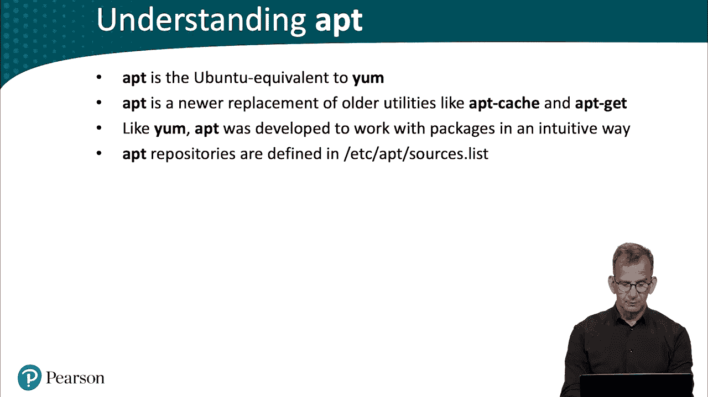
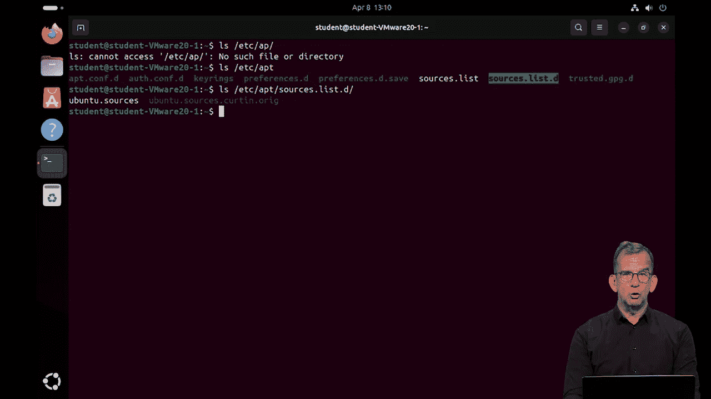
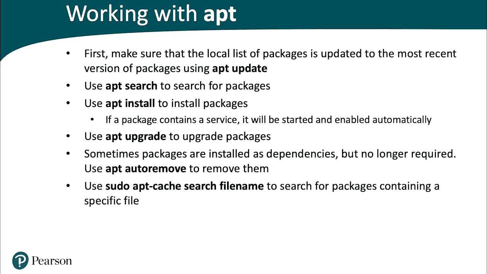
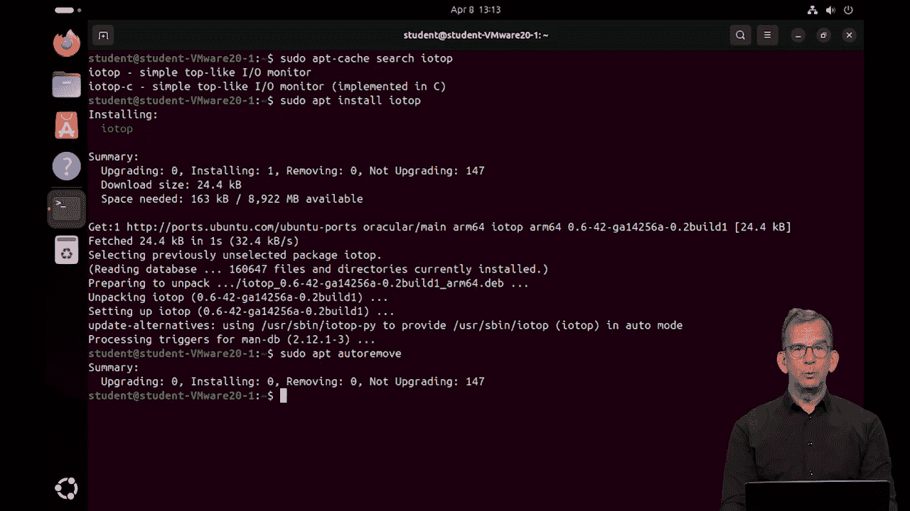

# CompTIA Linux+ V8：05：使用 apt 管理 Ubuntu 软件包 📦

在本节课中我们将要学习 Ubuntu 上的包管理工具 apt。apt 是 Ubuntu 系统里安装、升级和删除软件包的主要方式，类似于其他发行版里的 yum。我们会先看看 apt 是什么，再了解一下软件源的配置文件，然后学习常用的 apt 命令，最后通过几个实际例子看看怎么操作。

首先我们来认识一下 apt。apt 的全称是高级包管理工具，它是 Ubuntu 系统里用来处理软件包的程序。简单来说，apt 就是 Ubuntu 对应 yum 的工具，帮你从网络上的软件源下载并安装程序。

在老版本的文档里，你可能会看到 apt-cache 和 apt-get 这样的命令，这些是以前常用的工具。不过现在 apt 通常已经取代了它们，所以如果你只用 apt 就足够了，不用太担心会漏掉什么功能。



apt 的设计初衷就是让管理软件包变得直观好用，它会读取定义在 /etc/apt/sources.list 里的软件源列表，然后根据这些地址去下载你需要的东西。

```bash
apt = 高级包管理工具 (Advanced Package Tool)
```

接下来我们看看 apt 是怎么知道去哪里下载软件的。这一切都跟软件源有关。

在 Ubuntu 里，apt 的主配置文件是 /etc/apt/sources.list。如果你用 ls 命令查看 /etc/apt 目录，除了 sources.list，你还会看到一个叫 sources.list.d 的子目录。

这是 Linux 系统里很常见的一种设计模式：有一个主配置文件，再配合一个以 .d 结尾的目录来存放额外的配置片段。主配置文件通常是由系统发行版提供的，在系统更新时可能会被覆盖。所以我们不建议直接修改 sources.list 这个主文件，因为你改的内容可能在下次更新后丢失。

正确的做法是把你自己的软件源配置放到 sources.list.d 目录里。这个目录的名字就是主文件名加上 .d 后缀，也就是 sources.list.d。不过使用这个目录时要注意文件格式，在 Ubuntu 里，放在这里的文件名通常需要以 .sources 结尾，否则 apt 不会去识别它。

```bash
主配置文件：/etc/apt/sources.list
扩展配置目录：/etc/apt/sources.list.d
推荐文件后缀：.sources
```

上一节我们介绍了软件源的配置位置，本节中我们来看看具体怎么用 apt 来操作软件包。

使用 apt 之前，你需要知道几个基本命令。以下是常见的操作步骤：

- apt update：先更新本地的包列表，让系统知道仓库里有哪些新版本。
- apt search：在软件源里搜索你想要的包。
- apt install：把找到的包安装到系统中。
- apt upgrade：把系统里已经安装的包升级到最新版本。
- apt autoremove：删掉那些曾经作为依赖安装，但现在已经不再需要的包。



另外，在 Ubuntu 里，如果你安装的包包含系统服务，安装完成后这些服务通常会自动启动并且设置为开机自启，所以你一般不需要手动运行 systemctl enable 之类的命令。

如果你想根据某个具体的文件名去搜索哪个包里包含这个文件，可以用 apt-cache search 命令，这在你不知道包名但知道文件名的时候很有用。

光说不练假把式，下面我们来看几个实际的命令示例。

首先运行更新命令，让系统同步最新的包索引：

```bash
sudo apt update
```

执行后你会看到有多少个包可以升级，比如这里显示有 140 个包可以升级。

如果你想具体看看哪些包可以升级，可以用：

```bash
sudo apt list --upgradable
```



演示里为了节省时间就没执行这一步，但你完全可以自己试一下。

假设你想找一个叫 iotop 的工具，它可以用来监控磁盘 I/O 性能。你可以先搜一下：

```bash
sudo apt-cache search iotop
```

搜索结果显示，包名恰好也是 iotop。知道包名之后，直接安装就行：

```bash
sudo apt install iotop
```

安装完成后，iotop 就可以使用了。

最后，你也可以运行自动清理命令，看看有没有可以删除的多余依赖：

```bash
sudo apt autoremove
```

不过如果系统里没有不再需要的依赖，这个命令执行完之后不会有什么输出，结果可能会让人觉得有点失望，但这其实是说明系统很干净。

apt 就像 dnf 一样是为了直观好用而开发的，如果你不确定某个命令怎么用，可以直接查看帮助文档尝试，并不难。在下一个视频里你会学到在 Ubuntu 上处理软件包的新方式。



本节课中我们一起学习了 Ubuntu 的包管理工具 apt。我们了解了 apt 是什么，它取代了老旧的 apt-get 和 apt-cache 工具；学习了软件源的配置文件 /etc/apt/sources.list 和扩展目录 sources.list.d，知道了不要直接改主配置文件，而应该把自定义源放到 .d 目录里；还掌握了 apt update、apt search、apt install、apt upgrade、apt autoremove 等常用命令，并通过 iotop 的例子看完了完整的安装流程。

