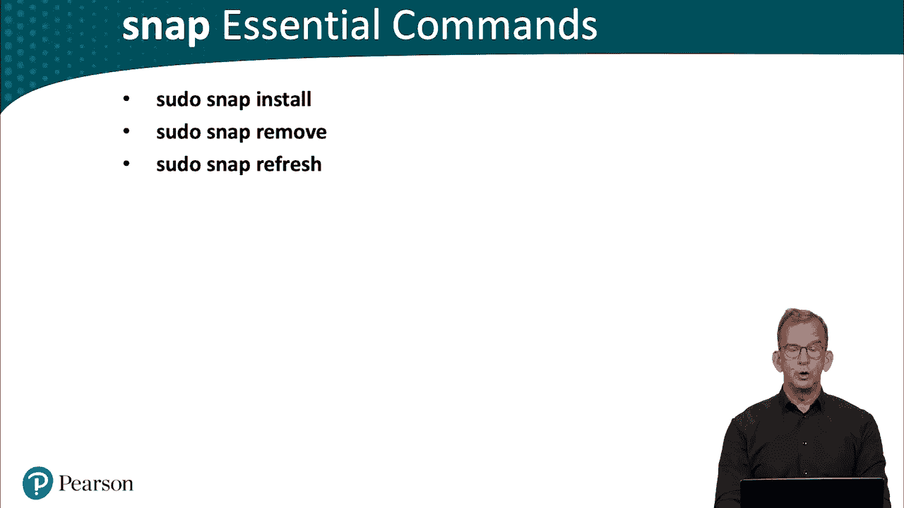
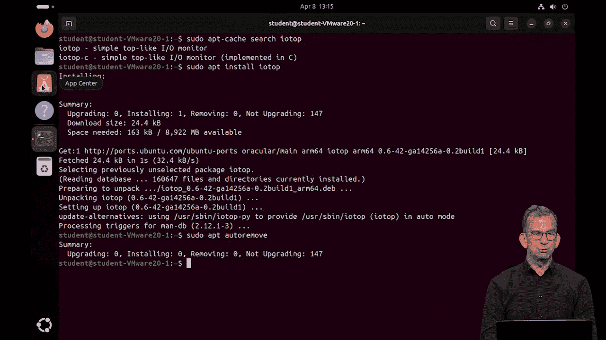
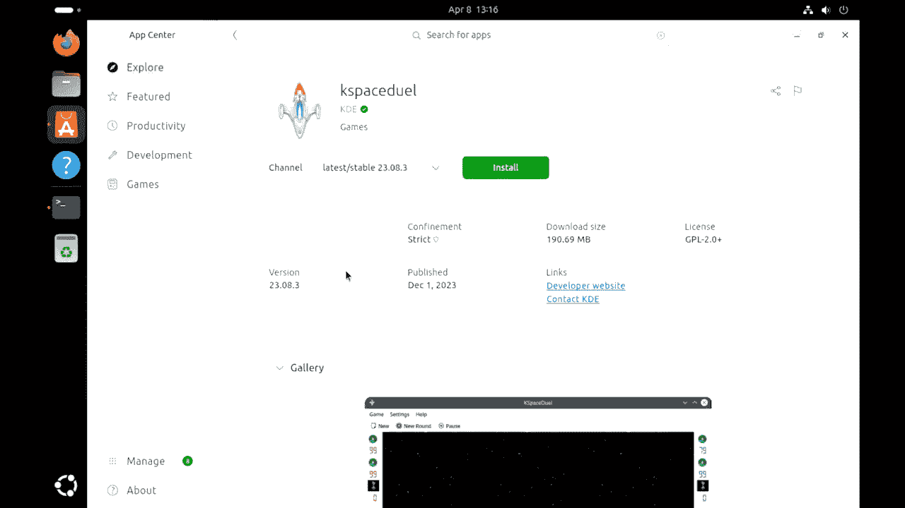
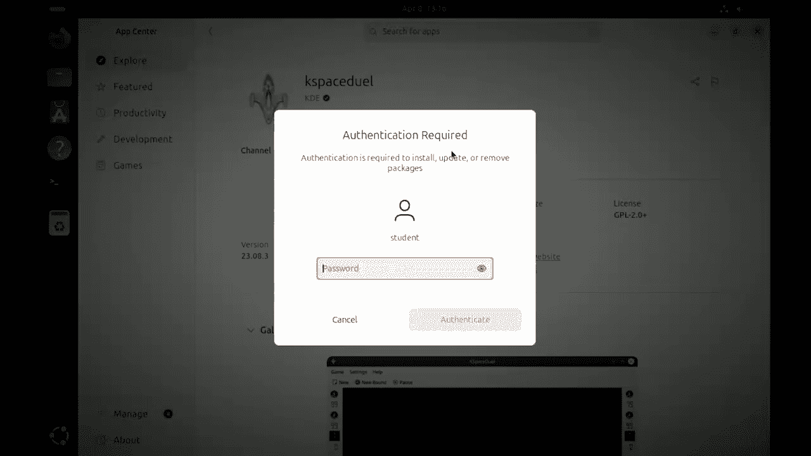
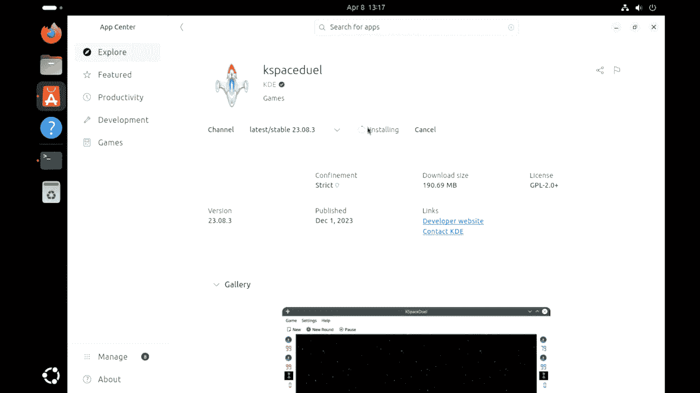
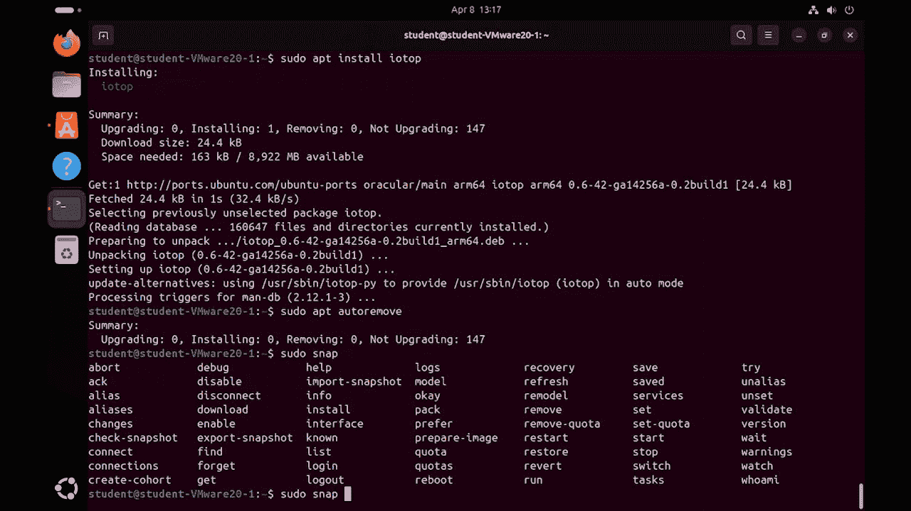
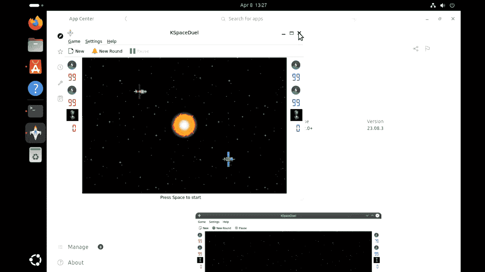

# CompTIA Linux+ V8：158：使用Ubuntu Snap 📦

在本节课中，我们将学习如何在Ubuntu系统中使用Snap来管理软件包。Snap是一种比较新的软件安装方式，很多初学者可能对它还不太熟悉，没关系，我们会一步步把它讲清楚，让你明白它是怎么回事，怎么用，以及有什么注意事项。

## 什么是Snap 🔍

上一节我们可能介绍过传统的软件包管理方式，本节中我们来看看Snap这个新东西。

最近，Ubuntu系统上安装了一种用于管理软件的新工具，名为Snap。简单来说，Snap是一个高级包管理器，它应用容器技术，在隔离环境中运行软件包。你将在课程19中了解容器是什么。现在你只需要记住一点：Snap在隔离环境中运行软件包。

这些软件包从Ubuntu Snap商店中安装。这个商店也支持第三方软件提供商提供软件。这一点并非所有人都认同，因为第三方提供商甚至可以对自己的软件收费。但是Ubuntu希望提供一种方式，让这些软件解决方案也能被大家访问到。

Snap的好处在于，Snap软件包在安装时会将所有依赖项一起放在隔离环境中。因为在Snap中运行时，软件包与其他软件包是隔离的。你可以在同一系统上运行使用不同库版本的软件包，因为一个软件包看不到另一个软件包需要什么。

虽然Snap很高效，但Snap应用程序需要更多的磁盘空间，而且安装速度比使用其他包管理器（如APT）要慢。现在有些软件包只能在Snap中获得，一个例子就是Firefox浏览器。

## Snap的核心特点 ⚖️

了解完Snap的基本概念之后，我们再看看它的具体表现。Snap最大的特点就是把软件和依赖打包在一起，互不干扰，但代价是占用空间更大，安装也慢一些。

以下是Snap的主要特点：

- 软件包自带所有依赖，安装在隔离环境中
- 不同的软件包可以使用不同版本的库，互不冲突
- 占用磁盘空间较多
- 安装速度通常比传统包管理器慢

有些软件只能通过Snap安装，比如Firefox浏览器，所以即使你平时用apt，也可能不得不接触一下Snap。

## 使用Snap商店安装软件 🛒

命令行固然强大，但对于初学者来说，图形界面往往更直观。开始使用Snap最好的方式是通过Snap商店，官方名称可能是Snap Store。下面我们来看看商店里长什么样。

在这里你可以看到所有可用的Snap，选择你想要的任何软件。我们看到有游戏，还有很多其他东西。让我看看有没有什么好游戏。这里有各种游戏，说实话，我没看到什么有趣的，但我们选KSpaceDuel吧，它是为KDE开发的。我很好奇，它在我的非KDE环境中能否运行，因为KDE是一个竞争性的桌面环境。我就点击KSpaceDuel，然后输入密码。

它正在安装，安装需要一段时间，如你所见进度很慢。安装完成后，你就可以打开软件使用了。

## 常用Snap命令 💻

除了图形界面，命令行也是管理Snap的重要方式。现在我们来看一些重要命令，让我演示一下它是如何工作的。

以下是常用的Snap命令：

- `sudo snap` 按两次Tab键：显示所有可用的Snap命令
- `snap list`：列出系统上所有的Snap，包括GNOME、Snap Store等
- `sudo snap remove <软件名>`：删除不再需要的Snap
- `sudo snap refresh`：尝试更新所有已安装的应用程序

在实际操作中，安装软件需要一点耐心。如你所见，执行更新时会下载所有应用程序的最新版本，这会花一些时间。等待结束后，我们可以看到KSpaceDuel已安装，点击打开即可运行。它作为Snap应用程序正常运行，虽然我自己不太懂这个游戏怎么玩，但至少它跑起来了。

回到命令行，我们之前执行的`sudo snap refresh`已经刷新了所有内容。还有一个小事，我们安装了Snap和桌面集成，可能在开始使用之前最好重启系统。

## 本节总结 📝

本节课中，我们一起学习了Ubuntu Snap的基本概念、Snap商店的使用方法，以及常用的Snap命令行操作。Snap通过容器技术实现软件隔离，虽然占用空间较大且安装较慢，但它能解决依赖冲突问题，并且有些软件只能通过Snap获得。希望大家在课后可以动手尝试一下，在自己的Ubuntu系统上安装一个Snap软件包。
