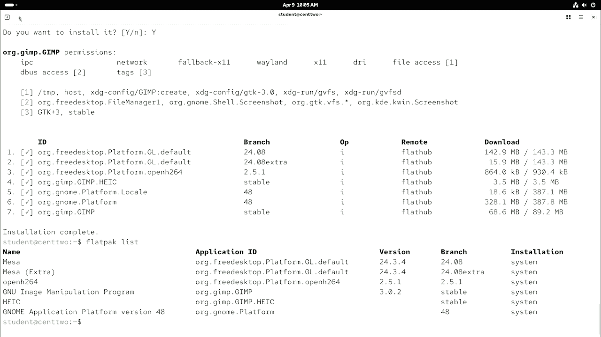
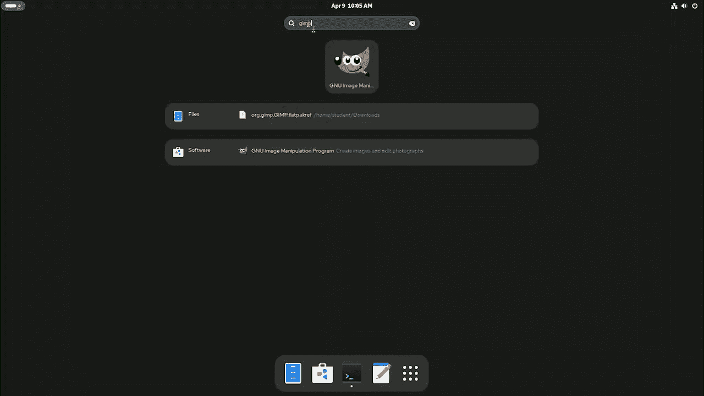
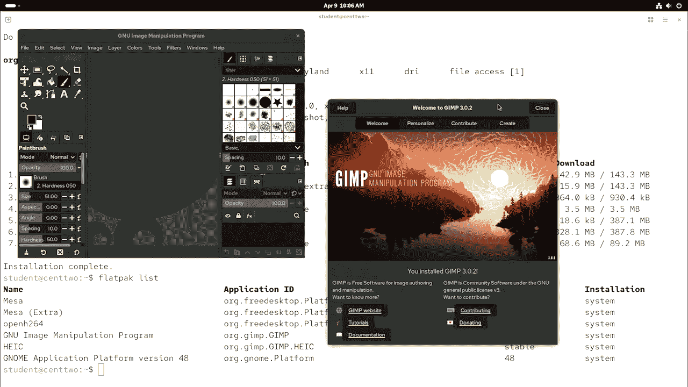

CompTIA Linux+ V8 教程：160：使用 Flatpak 📦

在本节课中我们将要学习 Flatpak 是什么，以及如何在 Linux 系统中安装和使用 Flatpak 应用程序。Flatpak 是一种独立于发行版的软件包格式，它允许你在不同的 Linux 发行版上运行相同的桌面应用程序。我们将通过实际操作来了解 Flatpak 的安装流程，包括如何添加软件仓库、如何查找应用程序，以及如何验证安装结果。无论你是使用 Ubuntu 还是 Fedora，理解 Flatpak 都能帮助你更灵活地管理桌面软件。接下来的内容会分步骤讲解，请跟随操作一起尝试。


什么是 Flatpak 📦

上一节我们介绍了 Snap 的基本用法，本节中我们来看看 Flatpak。在 Ubuntu 系统中，我们通常使用 Snap。而在 Fedora 以及所有其他 Linux 发行版中，我们使用 Flatpak。Flatpak 正在将自身发展为一种类似发行版的独立标准。它是 Snap 的替代方案，不依赖于集中式应用商店。但它使用远程仓库，并且和 Snap 一样，在隔离的容器化环境中安装应用程序。

Flatpak 的核心工作方式可以用以下代码片段描述：

```text
应用程序 = 隔离容器环境 + 远程软件仓库
```

这意味着 Flatpak 应用程序不直接安装在系统核心目录中，而是运行在自己的容器里，这样可以避免与系统其他部分发生冲突。为了方便你理解，我来演示它的工作流程，所有步骤都在当前幻灯片上。


安装 Flatpak 软件包 📥

了解了基本概念之后，我们现在动手开始安装 Flatpak 本身。以下是安装命令：

```bash
sudo dnf install flatpak
```

这条命令会下载并安装 Flatpak 所需的基础组件。安装过程需要超级用户权限，所以系统会提示你输入密码。输入密码后，安装程序会开始运行，请耐心等待它完成。


添加 Flathub 软件仓库 🔗

安装完 Flatpak 软件包之后，下一步是添加软件仓库，这样系统才知道从哪里下载应用程序。以下是添加仓库的命令：

```bash
flatpak remote-add --if-not-exists flathub https://flathub.org/repo/flathub.flatpakrepo
```

这里指定了仓库名称为 flathub，对应的地址是 https://flathub.org/repo/flathub.flatpakrepo。`--if-not-exists` 参数表示如果仓库已经存在，就不重复添加。这条命令也需要超级用户权限，所以记得输入你的密码，然后等待命令执行结束。


安装网页浏览器 🌐

仓库添加完成之后，为了通过图形界面来使用 Flatpak，你需要一个网页浏览器。默认情况下，系统可能没有预装浏览器。如果没有浏览器，我们需要先安装 Firefox，命令如下：

```bash
sudo dnf install firefox
```

安装完成后，你就可以启动浏览器了。如果你想要 Flatpak 的图形化界面，实际上浏览器就是默认的图形化界面，因为 Flathub 的软件商店是基于网页的，没有专门的桌面客户端。


通过浏览器查找和下载应用程序 🔍

浏览器准备好之后，我们可以访问 Flathub 官方网站来查找需要的软件。在浏览器中，我访问 flathub.org。在那里，我可以搜索软件包并下载它们。我打算使用 GIMP，这是一个图形图像处理程序。

GIMP 的全称是 GNU 图像处理程序。不管是不是图形化的，这都是一个不错的应用程序。它是图形化应用程序。说到底，Flatpak 和 Snap 主要关注的就是桌面应用程序，而不是服务器应用。所以我将在浏览器中点击安装按钮，开始获取 GIMP 的安装文件。

你可以看到安装已经完成。


安装 Flatpak 应用包文件 📦

浏览器下载完成之后，此刻安装过程可能会让人感到困惑，因为你可能会觉得现在我们完成了，但实际上还没有。所以让我们检查一下软件包是否存在。它位于下载目录中，我可以使用 Flatpak 来安装它。以下是安装命令：

```bash
flatpak install downloads/org.gimp.GIMP.flatpakref
```

这将安装该软件包，使其在运行时可用。系统会询问你是否要安装，回答是。我想要安装它，并且同意执行所有请求的更改。

现在 Flatpak 应用程序是为完全隔离运行而开发的，因此你需要安装比普通应用更多的文件。不要惊讶于单个 Flatpak 应用程序可能有几百兆的数据量，这是因为它包含了运行所需的所有依赖库和运行环境。


验证安装结果 ✅

文件安装完成之后，我们可以进行验证，确认应用程序是否真的被系统识别。使用以下命令查看已安装的 Flatpak 应用程序：

```bash
flatpak list
```

你可以看到已经安装的所有不同组件。这意味着 GIMP 应用程序此时已经准备就绪，可以使用了。这就是使用 Flatpak 的完整方法。


启动和访问应用程序 🚀

验证完成之后，你可能会想，我们如何访问刚才安装的应用程序呢。GIMP 是图形化应用程序，所以我建议去系统搜索栏输入 GIMP，然后你会看到 GNU 图像处理程序。点击图标即可启动，现在可以使用了。





这就是 Flatpak 做的事情，它是 Snap 或 Ubuntu 的发行版独立替代方案。无论你在哪个 Linux 发行版上，都可以通过相同的方式安装和运行桌面应用程序，不需要为不同的发行版寻找不同的安装包。


本节课总结 📚



本节课中我们一起学习了 Flatpak 的基本概念，掌握了安装 Flatpak、添加 Flathub 仓库、安装浏览器、通过浏览器下载 GIMP、安装 Flatpak 应用包、验证安装结果以及启动应用程序的完整流程。Flatpak 通过容器化隔离和远程仓库，为 Linux 桌面应用提供了发行版独立的解决方案。希望这节课能帮助你更好地理解和使用 Flatpak。

