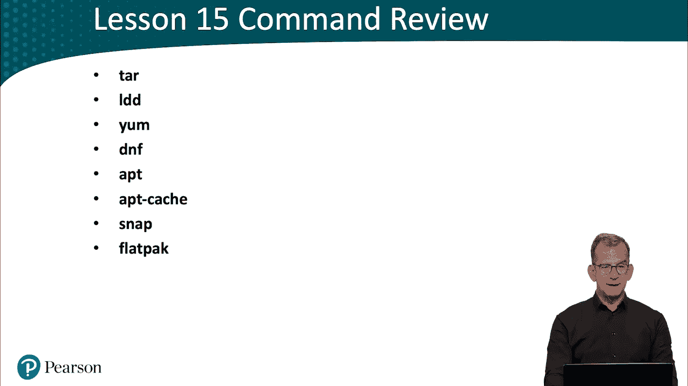
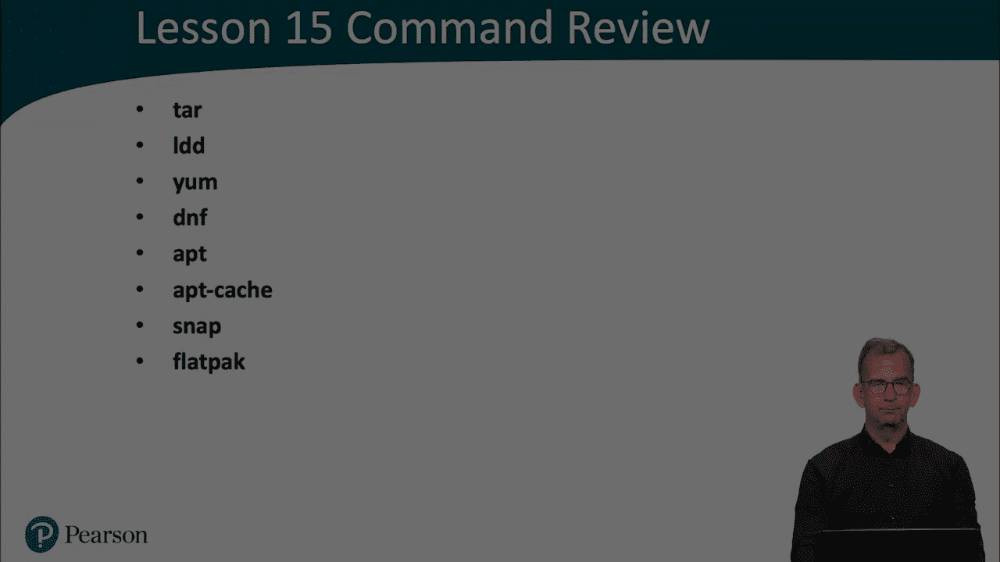

# CompTIA Linux+ V8：161：1510命令复习🐧


在本节课中，我们将一起回顾本课之前学习过的各种 Linux 命令，弄清楚每个命令的基本用途和适用场景，为接下来的实验操作打下坚实基础。无论你是刚接触 Linux 的新手，还是想要复习一下旧知识，这节课都会把常用命令理一遍，让你对整体知识脉络有更清晰的认识。


我们来看看本课中出现过的命令，这些命令涵盖了软件安装、库分析、包管理以及隔离软件管理等多个方面的内容，下面我们将逐一进行说明。


## 一、源码安装与库分析命令

上面我们简单介绍了本课会回顾哪些命令，本节中我们来看看与源码安装和库分析相关的命令，这部分内容比较偏底层，但对理解程序如何运行非常有帮助。

以下是源码安装与库分析相关的命令说明：

- CTR：用于从源代码进行软件安装。
- LDD：用于分析程序运行时依赖的共享库。

LDD 命令的核心作用可以用这个简单的公式来理解：

```text
LDD 可执行文件路径 = 列出该文件依赖的所有共享库
```

换句话说，当你不确定一个程序启动时需要哪些库文件，或者程序因为缺少库而无法运行时，就可以用 LDD 来检查，避免盲目安装无关的软件包。


## 二、Red Hat 家族包管理命令

刚才我们介绍了源码安装和库分析相关的命令，本节中我们来看看 Red Hat 系列系统常用的包管理工具，这些工具是日常系统维护中最常接触到的命令之一。

以下是 Red Hat 及其衍生发行版使用的包管理命令：

- UM：用于在 Red Hat 系列系统中管理软件包。
- DNF：用于在 Red Hat 系列系统中管理软件包。

这两个工具的主要职责是安装、升级、删除和查询软件包，适用于 RHEL、CentOS、Fedora 等系统。在实际工作中，你会频繁使用它们来保持系统软件处于最新状态，或者解决软件依赖问题。


## 三、Ubuntu 家族包管理命令

前面我们讲了 Red Hat 家族的包管理命令，本节中我们来看看 Ubuntu 及其相关系统使用的包管理命令，这部分内容适用于 Debian 及其衍生版本。

以下是 Ubuntu 及相关系统使用的包管理命令：

- apt cache：用于在 Ubuntu 系列系统中管理软件包缓存和元数据。

apt cache 常用于搜索可用的软件包、查看包信息以及管理本地缓存，是 Debian 系系统包管理的重要组成部分。掌握它后，你可以更方便地在 Ubuntu 系统上查找和管理软件。


## 四、隔离软件管理器

刚才我们分别介绍了不同发行版的传统包管理命令，本节中我们来看看两种跨发行版的隔离软件管理工具，它们的出现是为了解决不同 Linux 发行版之间软件分发不统一的问题。

以下是隔离软件管理器及其对应的发行族群：

- Snap：Ubuntu 的隔离软件管理器，用于安装和运行与系统隔离的应用程序。
- Flatpak：Red Hat 家族对应的等效工具，提供类似的应用隔离和分发功能。



这两种工具的最大特点是将应用及其依赖打包在一起，减少与底层系统库的冲突，适合在不同的 Linux 发行版上统一分发桌面应用。如果你希望安装的软件不受系统版本限制，可以考虑使用它们。


## 五、进入实验环节



上面我们完成了对本课各类命令的回顾，包括源码安装、库分析、不同发行版的包管理工具以及隔离软件管理器。下面我们进入实验环节，在实际操作中进一步巩固这些命令的使用方法，把理论知识转化为动手能力。


## 总结

本节课中我们一起学习了本课出现过的各种 Linux 命令，包括用于源码安装和库分析的命令，Red Hat 家族和 Ubuntu 家族的包管理命令，以及 Snap 和 Flatpak 等隔离软件管理器。这些内容为接下来的实验操作奠定了基础，建议你在动手实验时重点关注每个命令的具体参数和实际应用场景，确保能够熟练掌握。
