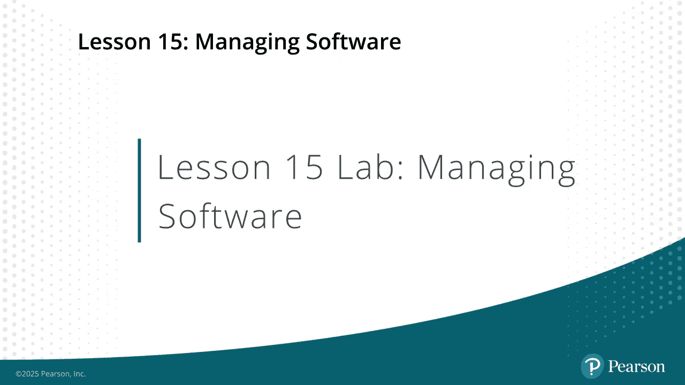
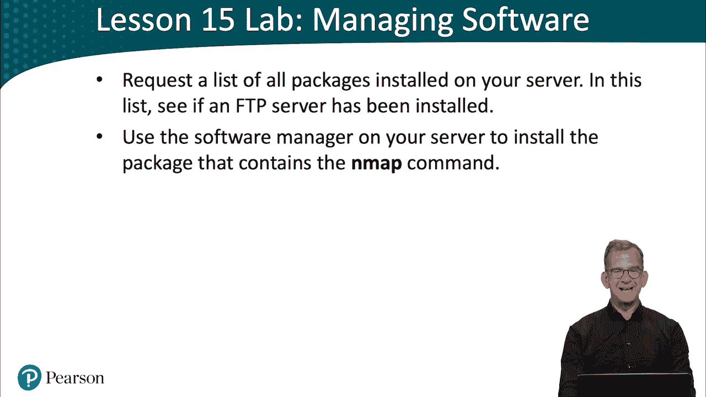

# CompTIA Linux+ 学习教程：第15课：软件管理实验 🛠️


在本节课中，我们将学习如何在Linux服务器上管理已安装的软件。整个实验分为三个主要步骤，首先是查看服务器上当前安装了哪些软件包，然后是检查其中是否包含FTP服务器，最后是使用服务器自带的软件管理器安装包含NMap命令的软件包。我们会用最直白的语言把每个操作拆解开来，即使你是第一次接触Linux软件管理，也能跟着步骤一步步完成。


## 第一步：列出服务器上所有已安装的软件包 📦


在开始任何安装或检查工作之前，我们需要先清楚服务器里已经有哪些软件。软件包就是Linux系统中用来封装程序及其依赖文件的安装单元，你可以把它理解为手机上的应用程序安装包。列出所有已安装的软件包，是软件管理中最基础也是最重要的操作，因为只有知道现有软件清单，才能判断需要安装什么、卸载什么，或者升级什么。


以下是查看已安装软件包的常用命令：


- 在Debian或Ubuntu系统中，使用 dpkg -l 命令列出所有已安装的软件包。
- 在Red Hat、CentOS或Fedora系统中，使用 rpm -qa 命令列出所有已安装的软件包。
- 这两个命令都会输出一个很长的列表，里面包含软件包名称、版本号、安装状态等信息。


代码示例如下：



```bash
# Debian/Ubuntu 系统
dpkg -l

# Red Hat/CentOS 系统
rpm -qa
```


运行这些命令后，屏幕上会显示大量文本，你可以滚动查看，或者结合其他命令进行过滤，这样更容易找到你关心的软件。


## 第二步：检查列表中是否安装了FTP服务器 🔍


上一节我们介绍了如何列出服务器上所有已安装的软件包，本节中我们来看看如何从这个长长的列表里，找出是否已经安装了FTP服务器。FTP服务器是用于在网络中传输文件的服务程序，常见的FTP服务器软件包名可能包含vsftpd、proftpd或pure-ftpd等关键词。如果你不确定具体的包名，可以通过关键词"ftp"在列表中进行模糊搜索。


以下是检查FTP服务器是否安装的方法：

- 在Debian或Ubuntu系统中，使用 dpkg -l | grep ftp 命令过滤列表。
- 在Red Hat或CentOS系统中，使用 rpm -qa | grep ftp 命令过滤列表。
- 如果命令有输出内容，说明系统中已经安装了与ftp相关的软件包；如果没有任何输出，则表示尚未安装FTP服务器。


代码示例如下：

```bash
# Debian/Ubuntu 系统
dpkg -l | grep ftp

# Red Hat/CentOS 系统
rpm -qa | grep ftp
```


通过这个步骤，你可以快速确认服务器的文件传输功能是否已经就绪，为后续的配置工作打下基础。


## 第三步：安装包含NMap命令的软件包 🚀


确认了FTP服务器的安装状态之后，本节中我们来看看如何安装NMap。NMap是一款非常有名的网络扫描工具，常用于检查主机上的开放端口、运行的服务以及操作系统类型等信息。在Linux系统中，NMap命令通常被封装在名为nmap的软件包里，我们需要使用系统自带的软件管理器将其下载并安装。


以下是安装NMap软件包的步骤：

- 在Debian或Ubuntu系统中，使用 sudo apt update 更新软件源，然后使用 sudo apt install nmap 安装NMap。
- 在Red Hat或CentOS系统中，使用 sudo yum install nmap 或 sudo dnf install nmap 安装NMap。
- 安装完成后，可以使用 nmap --version 命令验证NMap是否安装成功。


代码示例如下：

```bash
# Debian/Ubuntu 系统
sudo apt update
sudo apt install nmap
nmap --version

# Red Hat/CentOS 系统
sudo yum install nmap
# 或者
sudo dnf install nmap
nmap --version
```




安装完成后，你就可以在终端中直接使用nmap命令进行网络扫描了，这也是Linux系统管理员常用的网络诊断手段之一。


## 总结 📝


本节课中我们一起学习了如何在Linux服务器上管理软件包。具体完成了三个任务：首先使用 dpkg -l 或 rpm -qa 列出所有已安装的软件包，然后使用 grep 命令检查列表中是否包含FTP服务器，最后使用 apt 或 yum 等软件管理器安装包含NMap命令的软件包，并验证安装结果。这些操作构成了Linux软件管理的基础，掌握后你可以更方便地维护服务器上的软件环境。

