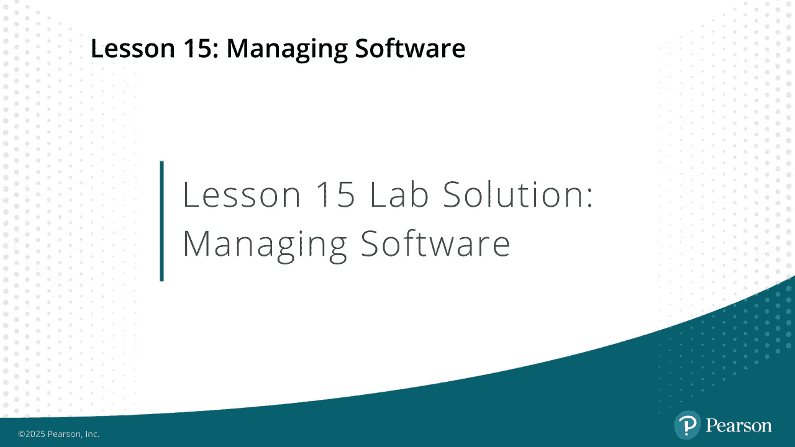
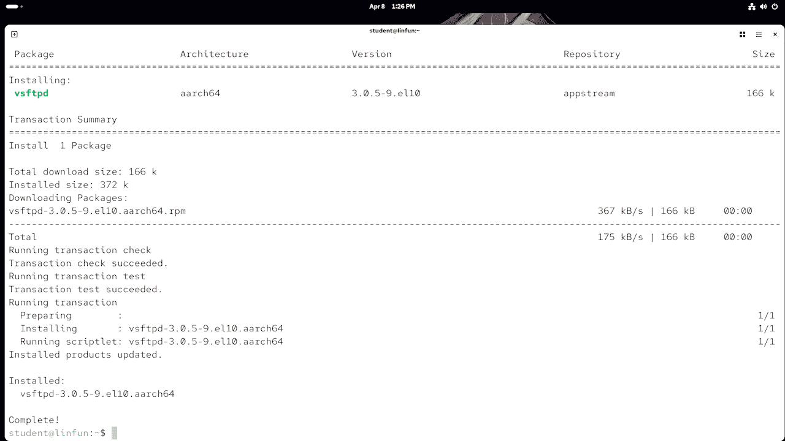
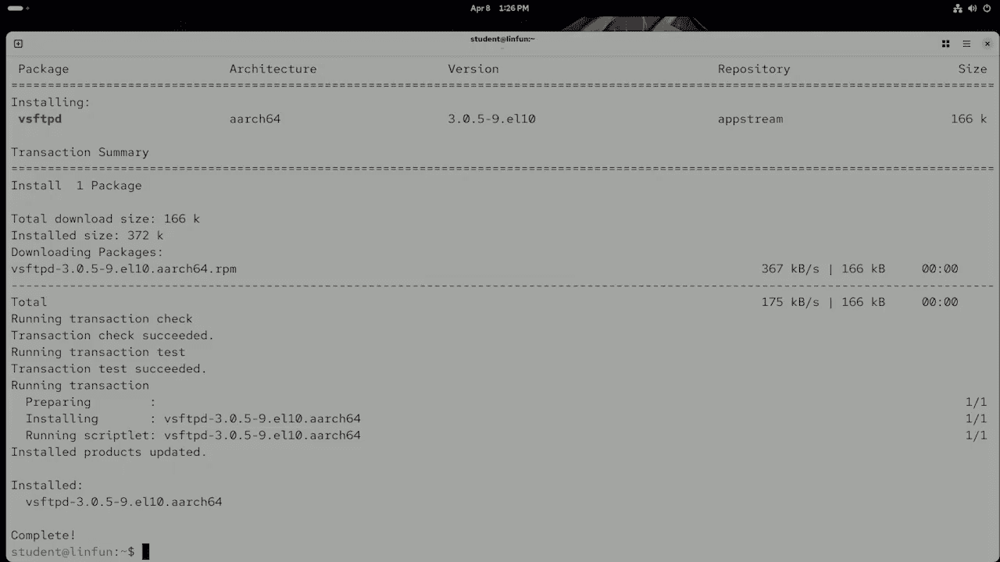

# CompTIA Linux+ V8：15：📦 管理软件



在本节课中我们将要学习如何在 Linux 系统里查看和管理已安装的软件包，重点是搞清楚一个软件到底有没有被安装，以及该怎么用软件管理器安装新的包。这对日常系统维护非常重要，因为很多时候我们以为装好了，其实并没有，或者明明没装，却误以为已经在系统里了。

## 检查软件包是否存在

上一节我们介绍了软件管理的基本概念，本节中我们来看看如何确认 FTP 服务器是否已经安装。最常用的方法是先执行下面这条命令，列出系统中跟软件包相关的信息：

```bash
sudo dnf list
```

如果不加任何参数，这条命令会显示所有相关的包列表。不过这里有个陷阱，软件包的名字不一定以 FTP 开头，所以光看到里面出现 vsftpd 这样的字样，并不能代表它真的已经安装好了。为了搞清楚真相，我们需要把所有已安装的包列出来，再筛选一下 vsftpd，命令如下：

```bash
rpm -qa | grep vsftpd
```

这条命令的意思是查询全部已安装包，然后用 grep 过滤出包含 vsftpd 的行。如果运行后没有任何输出，说明系统里并没有安装 vsftpd。问题就出在 sudo dnf list 的结果里，有些条目标记为已安装，有些则不是，而 vsftpd 正好属于后一种情况，它目前并未安装。

## 区分已安装与未安装包

刚才我们确认了 vsftpd 没有被安装，本节中我们来看看如何更准地区分哪些包是真的装好了，哪些只是列出来的。为了避免混淆，可以使用下面这条命令，它只显示当前系统中已经安装的包：

```bash
sudo dnf list installed
```

如果你想知道 FTP 相关的软件有没有装，把这个结果再交给 grep 处理即可：

```bash
sudo dnf list installed | grep ftp
```

执行之后你会发现，FTP 相关的包目前一个都没有安装。这就是在使用 sudo dnf list 时需要注意的地方，当输出结果是一大串包列表时，很容易把“列出来”和“已安装”搞混，所以一定要分清楚这两种状态。

## 安装软件包

上面我们分析完了怎么检查软件是否存在，本节中我们来看看如何真正安装一个包。如果你想安装 vsftpd，可以使用下面这条命令，其中 -y 参数表示自动同意所有提示，省去手动确认的步骤：

```bash
sudo dnf install -y vsftpd
```

不过在本次实验环境中，我们之前已经安装过 MMap 相关的工具，所以这里就不再重复安装 vsftpd 了。如果你愿意，也可以安装其他自己感兴趣的实用工具，方法完全一样，这就是本节实验需要完成的全部内容。



## 总结



本节课中我们一起学习了如何检查 FTP 服务器是否安装，如何用 rpm -qa 和 dnf list installed 区分已安装与未安装的包，以及如何使用 dnf install 安装新的软件包。希望这些内容能帮你更好地掌握 Linux 上的软件管理方法。
