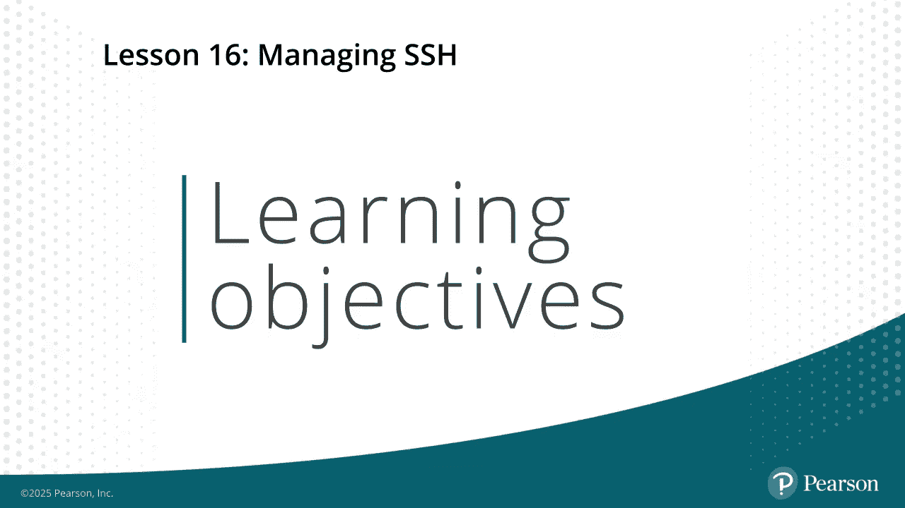
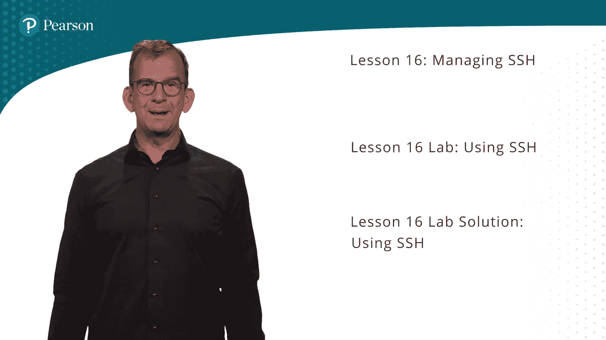

# CompTIA Linux+：164：SSH 学习目标 🔐

在本节课中我们将要学习关于 SSH 的基础知识。SSH 的全称是 Secure Shell，它是一种在网络中安全地连接远程计算机的协议。本节课一共包含四个视频，每个视频会讲解不同的知识点，帮助你逐步掌握如何使用 SSH 进行远程管理。

## 第一部分：运行 SSH 服务器需要了解的主题 🖥️

上一节我们介绍了本节课的整体安排，本节中我们来看看第一个视频的内容。运行 SSH 服务器并不复杂，但你需要知道哪些文件需要修改，哪些服务需要启动，才能让远程连接正常工作。

以下是运行 SSH 服务器需要掌握的核心主题：

- SSH 服务器软件的安装方法  
- SSH 服务的配置文件位置与作用  
- 防火墙中 SSH 默认端口的放行设置  
- SSH 服务的启动与状态查询  

代码示例：`systemctl start sshd`

## 第二部分：SSH 客户端常用选项 💻

了解完服务器端之后，本节中我们来看看 SSH 客户端的常用选项。客户端是我们用来发起连接的工具，掌握常用参数可以让连接更灵活，也能解决很多常见的连接问题。

以下是 SSH 客户端常用的命令行选项：

- `-p` 用于指定非默认的 SSH 端口  
- `-i` 用于指定用于身份验证的私钥文件  
- `-v` 用于显示详细的连接调试信息  
- `-l` 用于指定登录的用户名  

代码示例：`ssh -p 2222 -i ~/.ssh/id_rsa user@192.168.1.10`

## 第三部分：配置基于密钥的 SSH 登录 🔑

除了使用密码登录，本节中我们来看看更安全的登录方式。基于密钥的登录不需要每次输入密码，也能有效防止暴力破解，是生产环境中推荐的做法。

以下是配置基于密钥 SSH 登录的主要步骤：

- 在本地使用工具生成公钥和私钥对  
- 将生成的公钥复制到目标服务器  
- 在服务器上设置正确的文件权限  
- 可选地禁用密码登录以提高安全性  

代码示例：`ssh-keygen -t rsa` 和 `ssh-copy-id user@host`

## 第四部分：命令复习与实验解答 📝

在学完前三个视频的内容后，本节中我们来看看本节课的复习环节。复习可以帮助你巩固所学命令，实验解答则能让你知道具体操作中可能遇到的问题及其解决方法。

以下是本节课包含的复习环节：

- 本节课涉及的常用 SSH 命令回顾  
- 实验环境的入口与操作步骤说明  
- 实验任务的详细解答与思路分析  

本节课中我们一起学习了 SSH 的四个主要学习目标，包括运行 SSH 服务器所需的基础知识、SSH 客户端常用选项、基于密钥的登录配置，以及命令复习和实验解答。

