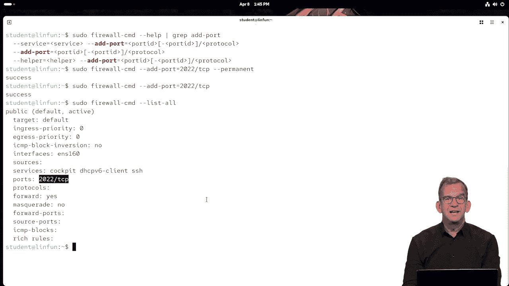
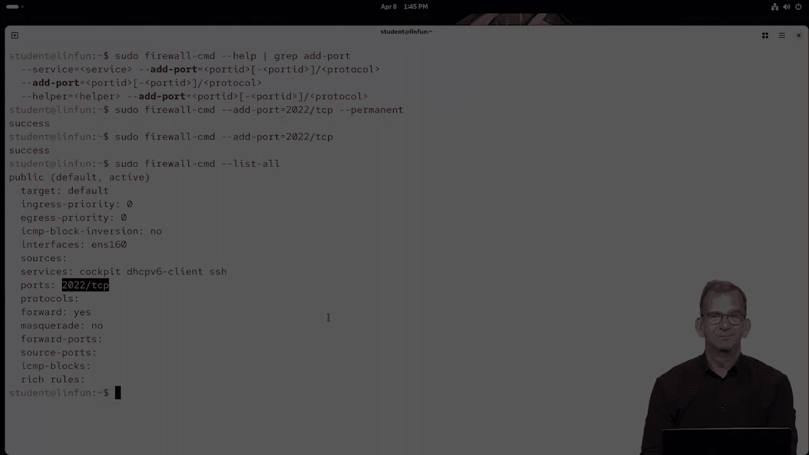

# 🖥️ CompTIA Linux+ V8：165：运行SSH服务器

在本节课中，我们将一起学习如何在Linux系统上运行SSH服务器。SSH是Linux上非常常用的一项服务，之前我们已经简单提到过它。现在是时候了解一些更进阶的功能了。SSH的核心作用是提供对Linux终端的远程访问，让你可以从别的地方连接到这台机器。在使用它之前，你可能需要先安装OpenSSH服务器，使用DNF或者APT等包管理器完成安装。安装好之后，还要确保服务已经启动并且设置为开机自启。在Ubuntu上这通常会自动完成，但在Red Hat系列系统中则需要你手动操作。

## 第一节：SSH的基础安装与启用

上一节我们简单介绍过SSH是什么，本节我们来看看如何把它安装好并让它运行起来。

SSH服务器并不一定在所有系统里默认安装，所以第一步就是把它装上。不同的发行版使用的包管理器不一样，Red Hat系列通常用DNF，Debian和Ubuntu通常用APT。安装完成后，你需要确认SSH服务已经被systemd启动，并且设置为开机自动启动。这样每次系统重启之后，SSH服务器都会自动运行，不需要你每次都手动去开。

以下是安装和启用SSH服务器的步骤：

- 在Red Hat系列系统上使用DNF安装OpenSSH服务器。
- 在Debian或Ubuntu系统上使用APT安装OpenSSH服务器。
- 检查并确保SSH服务已经启动，并设置为开机自启。
- 在Ubuntu上这一步通常会自动完成，在Red Hat系列系统中则需要手动执行。

```bash
# Red Hat系列安装OpenSSH服务器
dnf install openssh-server
# Debian或Ubuntu安装OpenSSH服务器
apt install openssh-server
```

## 第二节：加固SSH配置

安装好SSH服务器之后，我们还需要让它更安全。本节我们来看看可以在配置文件里调整哪些参数。

互联网上开放22号端口的SSH服务是暴力破解攻击的常见目标，所以默认设置并不足够安全。你可以修改/etc/ssh/sshd_config这个配置文件，调整几个关键参数来提升安全性。Port参数定义SSH监听的端口，默认是22。PermitRootLogin参数建议禁用，这样root用户就不能直接登录了。AllowUsers参数可以用来指定允许登录的用户列表，把权限限制给少数几个信任的用户，而不是让所有人都知道。PasswordAuthentication参数用来允许或禁止密码登录，如果你决定禁止密码登录，那么必须事先创建好SSH密钥，否则你自己可能也连不进去。

以下是可以在/etc/ssh/sshd_config中修改的安全参数：

- Port：定义SSH监听的端口，默认值为22。
- PermitRootLogin：建议设置为no，禁止root用户直接登录。
- AllowUsers：指定允许登录的用户名列表，只让少数人能登录。
- PasswordAuthentication：控制是否允许密码身份验证，禁用后必须先配置SSH密钥。

```bash
# 编辑SSH配置文件
sudo vim /etc/ssh/sshd_config
# 配置示例
Port 2022
PermitRootLogin no
AllowUsers alice bob
PasswordAuthentication no
```

## 第三节：配置防火墙放行SSH端口

SSH配置文件改好之后，还得告诉防火墙允许相关的流量通过，否则外部连接进不来。本节我们来看看如何开放端口。

如果你想让SSH在非默认端口上运行，就必须在防火墙里把对应的端口打开。不同的系统使用的防火墙工具不一样，Red Hat系列常用firewalld，而Ubuntu常用UFW。在firewalld系统上，你需要先添加SSH服务，如果使用非默认端口，还要额外添加该端口，最后重新加载防火墙配置才能生效。在Ubuntu上，则可以直接用UFW命令允许SSH访问，并单独允许2022号端口的TCP流量。

以下是在使用firewalld的系统上开放SSH的命令：

- 永久添加SSH服务：firewall-cmd --add-service=ssh --permanent
- 如果使用非默认端口，额外添加端口：firewall-cmd --add-port=2022/tcp --permanent
- 重新加载防火墙使配置生效：firewall-cmd --reload

```bash
# 添加SSH服务并永久生效
firewall-cmd --add-service=ssh --permanent
# 添加2022号TCP端口并永久生效
firewall-cmd --add-port=2022/tcp --permanent
# 重新加载防火墙
firewall-cmd --reload
# 快速检查端口是否已开放
firewall-cmd --list-all
```

以下是在Ubuntu上使用UFW的命令：

- 允许SSH通用访问：sudo ufw allow ssh
- 允许2022号TCP端口访问：sudo ufw allow 2022/tcp

```bash
# 允许SSH服务
sudo ufw allow ssh
# 允许2022号端口
sudo ufw allow 2022/tcp
```

## 第四节：Red Hat系系统上的SELinux处理

如果你使用的是Red Hat系列系统，除了防火墙，还有一个SELinux需要注意。本节我们来看看它是怎么回事。

SELinux是Red Hat系系统自带的一个安全系统，它会对服务的行为进行额外限制。默认情况下，SELinux不会允许SSH在非默认端口上运行，所以如果你想在Red Hat系系统上把SSH跑在2022号端口，必须在启动SSH服务器之前，先通过SELinux的策略工具把这个端口注册为SSH端口。否则SSH服务器根本无法启动。在执行相关命令时，如果语法写错了，可以查看man手册确认正确的参数顺序，比如协议和端口号的位置不能写反，需要以文档为准进行修正。

以下是在Red Hat系系统上允许SSH在非默认端口运行的命令：

```bash
# 将2022号TCP端口标记为SSH端口
sudo semanage port -a -t ssh_port_t -p tcp 2022
```

## 第五节：验证SSH服务器是否正常工作

所有的配置都完成之后，我们需要确认SSH服务器是否真的在新端口上监听，并且能够正常连接。本节我们来看看如何测试。

修改完/etc/ssh/sshd_config之后，记得要把Port从22改成2022，这样暴力破解攻击者需要花更长时间才能找到你的服务。配置文件改完后，必须重启SSH服务，更改才会生效，这是我们第一次遇到需要重启服务才能读取新配置的例子。重启之后，可以用ss -tln命令查看监听状态，你应该能看到2022号端口已经处于监听状态。然后可以用ssh localhost -p 2022连接到本地主机，做一个简单的连通性测试。

以下是验证SSH服务器运行状态的步骤：

- 修改配置文件，将Port改为2022。
- 重启SSH服务使更改生效。
- 使用ss -tln查看端口监听状态，确认2022号端口正在监听。
- 使用ssh localhost -p 2022测试本地连接。

```bash
# 重启SSH服务
sudo systemctl restart sshd
# 查看监听状态
ss -tln
# 测试连接本地主机的2022端口
ssh localhost -p 2022
```

## 总结





本节课中我们一起学习了如何运行和配置SSH服务器。我们了解了安装OpenSSH服务器的方法，学会了修改sshd_config加固安全性，掌握了在firewalld和UFW下开放SSH端口，还处理了Red Hat系系统上SELinux对非默认端口的限制。最后我们验证了SSH服务器可以在非默认端口正常监听和连接。
