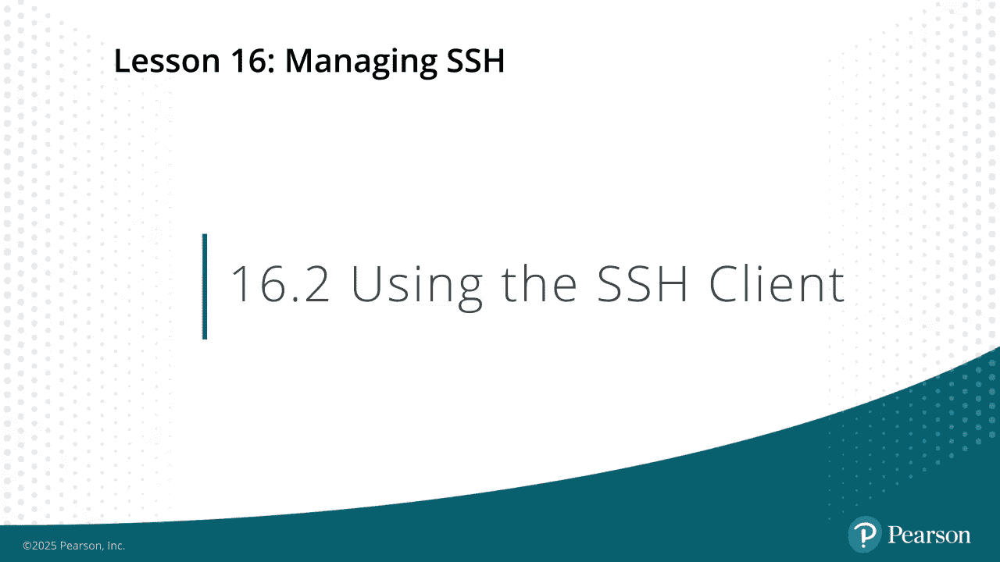
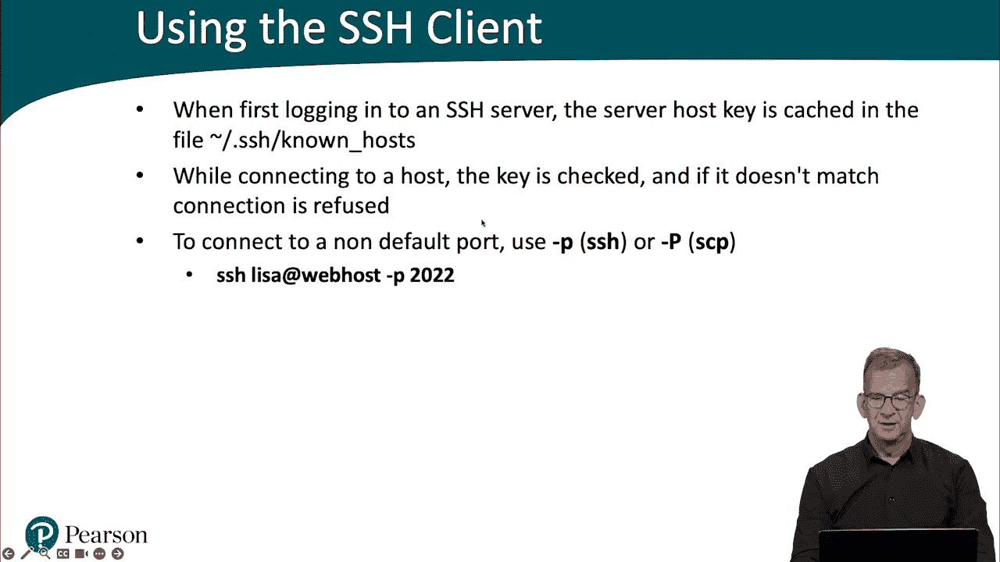
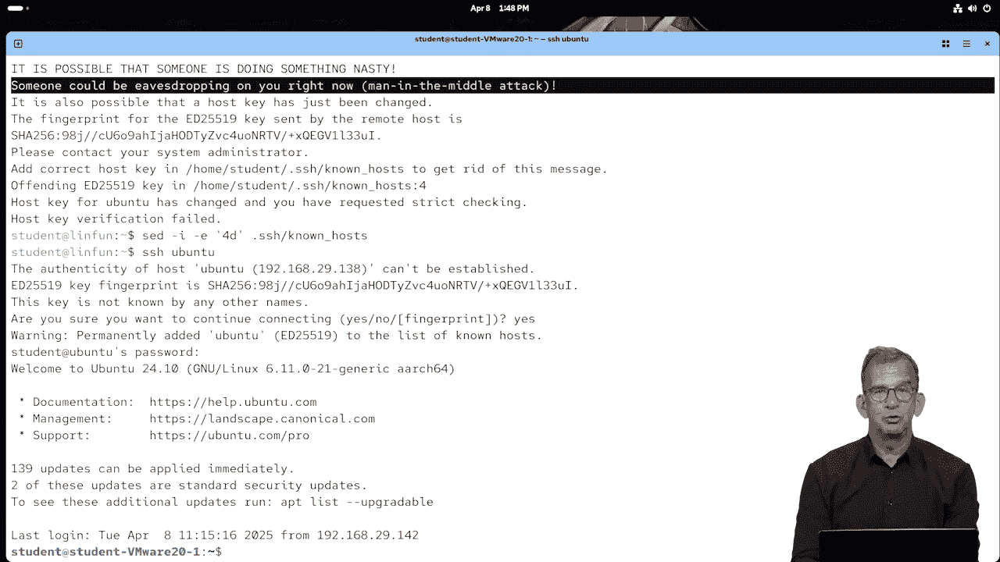

# CompTIA Linux+ V8：162：使用 SSH 客户端 🔐




在本节课中我们将要学习 SSH 客户端的相关知识。主要内容包括第一次登录 SSH 服务器时，服务器主机密钥是如何被保存和校验的，怎样连接使用非默认端口的服务器，当远程主机识别信息发生变化时会出现什么样的安全警告，以及遇到这种警告之后该如何手动清理失效密钥并重新连接。这些内容比较偏基础，非常适合刚开始接触 Linux 远程登录的初学者，大家不用担心，跟着讲解的节奏一步步来就可以了。

SSH 客户端的基本连接机制

下面我们先来看看 SSH 客户端在登录服务器时，底层到底发生了什么事情。当你第一次使用 SSH 登录一台远程服务器，服务器会把自己的主机密钥发送给客户端，客户端收到之后会把这个密钥保存在本地的 `~/.ssh/known_hosts` 文件里面。从第二次连接开始，每次发起连接时，客户端都会读取这个文件里存储的密钥，和服务器当前发送过来的密钥进行对比。如果两个密钥不一致，SSH 客户端会直接拒绝建立连接，这样可以防止你无意中登录到一个冒充服务器的恶意主机。

以下是首次连接和后续连接时的关键步骤：
- 客户端向 SSH 服务器发起连接请求
- 服务器把自己的主机密钥发送给客户端
- 客户端将密钥写入 `~/.ssh/known_hosts` 进行保存
- 下次连接时，客户端对比保存的密钥和当前密钥
- 密钥不匹配时，SSH 客户端拒绝连接



代码示例：
```bash
~/.ssh/known_hosts
```

连接非默认端口的服务器

上一节我们介绍了 SSH 客户端的密钥校验机制，本节中我们来看看如果目标服务器不是使用默认的 22 号端口，该怎么进行连接。默认情况下 SSH 服务监听在 22 号端口，但有些系统管理员会把端口改成其他数字，出于安全考虑避免被扫描。这时候你在使用 SSH 客户端时，需要在命令里显式指定端口号。需要注意的是，SSH 命令和 scp 命令指定端口的参数大小写不同，不要搞混。

以下是常用命令的写法：
- `ssh 用户名@主机名 -p 端口号`
- `scp 用户名@主机名:文件路径 -P 端口号`

假设你要连接一台名为 webhouse 的主机，登录用户是 lisa，端口是 2022，那么命令如下：
```bash
ssh lisa@webhouse -p 2022
```

服务器主机密钥变更时的安全警告

了解了端口连接之后，我们再看看当服务器的主机密钥发生变化时，SSH 客户端会显示什么样的警告。讲师特意修改了本地的 `~/.ssh/known_hosts` 文件，把里面的一些字符改乱了，模拟密钥不匹配的情况。再次发起连接时，终端会弹出一段警告提示，告诉你远程主机的身份标识已经改变。这种情况很可能意味着有人在搞破坏，你可能正遭遇中间人攻击，当前的连接是不安全的。

出现该警告的常见原因如下：
- 有人正在尝试中间人攻击，伪装成目标服务器
- 服务器已经重装系统，主机密钥被重新生成
- IP 地址被回收，之前的服务器和现在的服务器使用了相同的 IP 或主机名

警告信息示例：
```
WARNING: REMOTE HOST IDENTIFICATION HAS CHANGED!
```

删除失效密钥并重新连接

上一节我们介绍了警告产生的原因，本节中我们来看看如何手动移除失效的主机密钥，恢复正常的 SSH 连接。当系统提示 `known_hosts` 文件里某一行的密钥有问题时，你可以直接删除对应的那一行。比如错误出在第 4 行，就可以用删除命令把第 4 行去掉。删除之后再次连接，SSH 客户端会重新获取服务器的主机密钥，这次密钥是有效的，连接就能正常建立了。

修复失效密钥的步骤如下：
- 查看报错信息中指出的有问题的行号
- 使用 sed 或文本编辑器删除 `~/.ssh/known_hosts` 中的那一行
- 保存文件后重新发起 SSH 连接
- 接受并保存新的、有效的主机密钥

命令示例：
```bash
sed -i '4d' ~/.ssh/known_hosts
```



本节课中我们一起学习了 SSH 客户端的连接机制、非默认端口的连接方法、服务器主机密钥变更时的安全警告，以及如何手动清理失效密钥并重新建立信任连接。希望这些内容能帮助你更好地理解 Linux 远程登录背后的安全原理，在实际操作中遇到密钥不匹配时也能知道该怎么处理。

